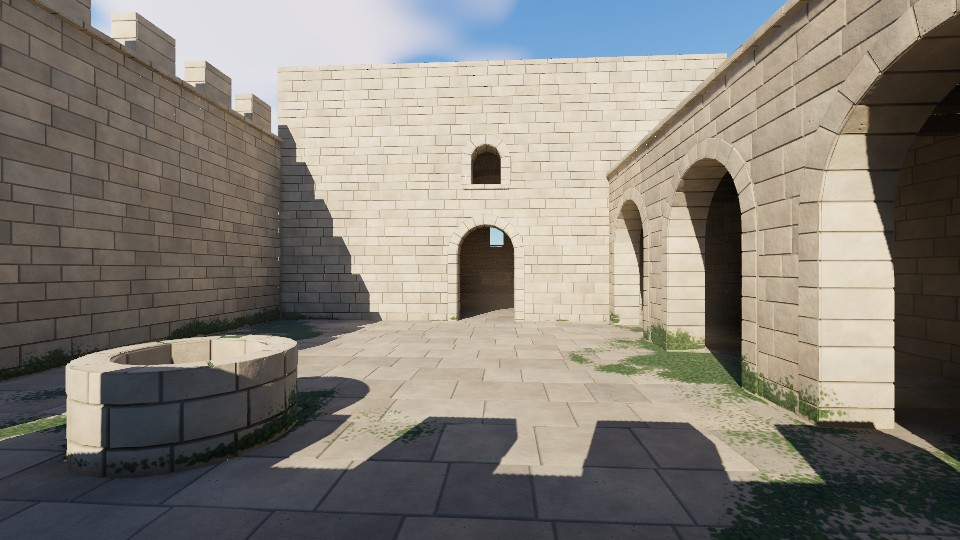

# Dungeons

A browser tool for generating places for adventure and exploring them: a 3D world in WebGL, 2D maps, and data a game can use.

"Dungeon" here means any bounded place worth exploring: crypts and caverns, castles, towns, and locations in open country.

The project is at an early stage. The design is written down in `docs/`, and the first 3D test scene runs in the browser: a sunlit courtyard and a torchlit vaulted hall, built stone by stone, with procedural materials and baked light. Nothing is generated from a site document yet.




More in `docs/images/`. These were captured from the running scene.

## Running it

```
npm install
npm run dev
```

Open the address Vite prints.

- **Mouse and keyboard:** click to walk; `W` `A` `S` `D` to move, `Shift` to run, `Space` to jump, `F` toggles fog, `B` toggles baked light.
- **Touch:** drag on the left side of the screen to move (a thumb stick appears under your finger; push well past its rim to run), drag on the right side to look, and tap the button to jump.

Useful URL parameters: `seed` (any text), `rays` and `bounces` (bake quality; defaults 48 and 2), `nobake`, `tex` (texture size), `dpr` (pixel ratio cap).

## Publishing

Every push to the default branch is built by GitHub Actions and written to the `gh-pages` branch (`.github/workflows/pages.yml`). To serve it, set Settings > Pages > Source to "Deploy from a branch", branch `gh-pages`, folder `/ (root)`. That is a one-time step.

## The idea in brief

A fantastic site is a place with a past, a shape you can learn and a rhythm you can feel. Generators usually get local detail right and global intent wrong, so this one works top-down:

1. Decide what the place is: who built it, what happened to it, who lives there now, and where it sits in the landscape.
2. Decide what the player does: a structure of nested loops, locks and keys, shortcuts and reveals.
3. Lay that structure out in space, with height, and shape the terrain and walls to hold it.
4. Give each district a biome that changes how the player moves, sees and thinks.
5. Build it, break it, move in: construct, apply history, then populate.
6. Light it deliberately and let its history show on every surface.
7. Verify it can be completed, measure how good it is, and keep the best of many.

## Documents

- [1. What makes it fantastic](docs/01-what-makes-it-fantastic.md) — design principles for sites and biomes, and the tests output is judged by
- [2. How to generate it](docs/02-generation.md) — the pipeline, site grammars, the data model and the quality model
- [3. The tool and the plan](docs/03-plan.md) — what gets built, technology, milestones, risks and decisions
- [4. The look](docs/04-look.md) — geometry, materials, lighting, performance and 2D map styles
