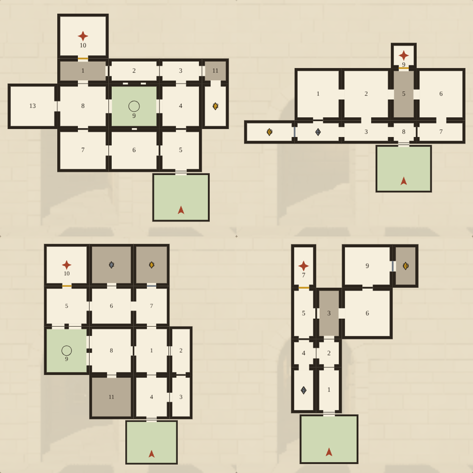
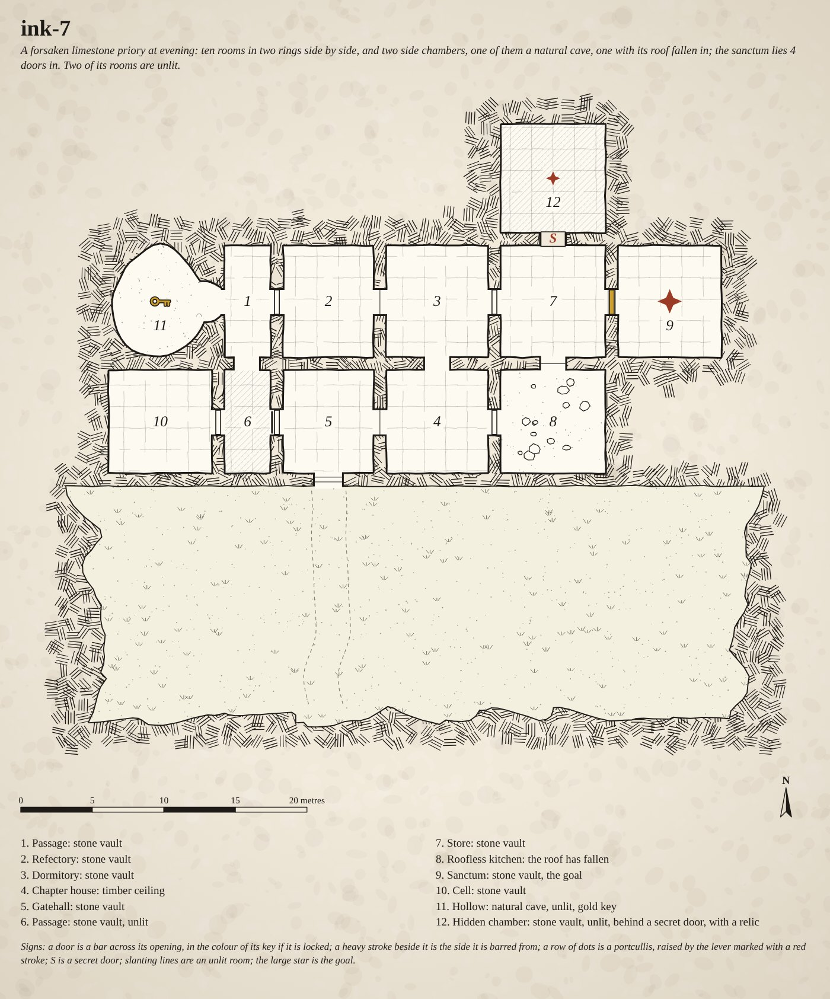
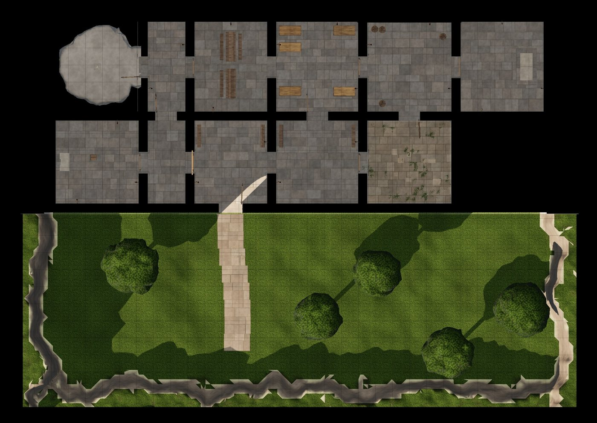
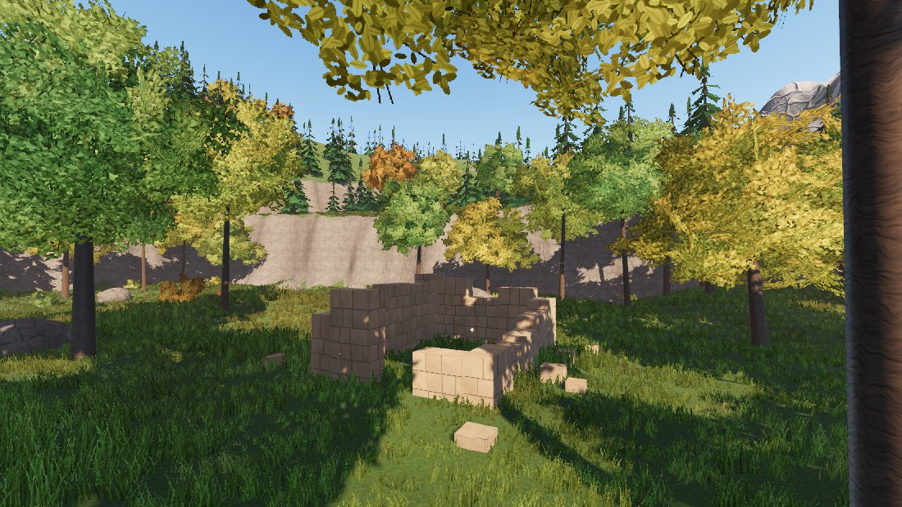
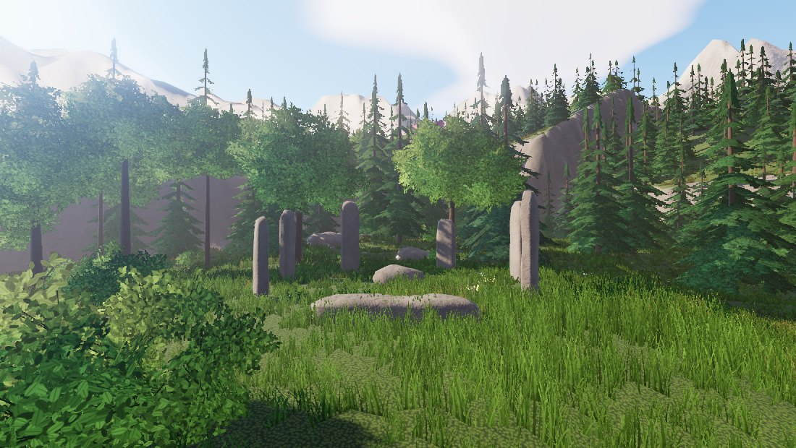

# Dungeons

A browser tool for generating places for adventure and exploring them: a 3D world drawn with WebGPU (or WebGL 2 where a browser has no WebGPU), 2D maps, and data a game can use.

"Dungeon" here means any bounded place worth exploring: crypts and caverns, castles, towns, and locations in open country.

The project is at an early stage. The design is written down in `docs/`; [How it works](public/how-it-works.html), published beside the tool as `how-it-works.html` and linked from its top row, is a guided tour of the whole, with diagrams. In the browser, each seed generates a small walled house — rooms arranged in loops, sometimes with a court open to the sky — built stone by stone, with procedural materials and baked light. Each has a locked sanctum to reach: keys to find, sometimes a second lock, sometimes a door barred from its far side or a portcullis with a lever beyond it, and a map that fills in as you explore. Every generated place is proven completable before it is shown.

A generated place (seed `check-0`): its cloister court, its sanctum, and its plan.


Four seeds, four plans: a ring round a court, two rings side by side, two rings one behind the other with a court to cross, and rooms off a central gallery. Stars mark the sanctum, diamonds the keys, coloured strokes the locked doors; shaded rooms are unlit.



The same place can be exported as a map drawn in ink, with everything a referee needs marked on it:



Or as a battle map: the built world itself from straight above, roofs cut away, ruled in 1.5 metre squares:



You arrive outdoors at the foot of a valley, in a forest, and walk up past fields and a pasture with sheep, through a small village on the slope under it, to the castle on the high ground over the valley's head (where the land has a seat for one; else at the head): a curtain wall with a gate between two towers, a tower or two more at its back corners, and within it the house, its hall and keep, with a chapel among its rooms and a dungeon under them. The whole valley can be walked; its sides are the land it lies in, and hills and mountains lie beyond:


Valleys differ from one place to the next in size and season, and in what they hold for whoever walks that far: a ring of standing stones on a rise, a pond with a landing stage, the ruin of a stone hut.







What grows is placed by rule, from shade, moisture, wear and soil: ferns under the trees, tall herbs in damp open ground, bushes at the edge of the wood, nettles about a ruin, and grass that is long where nobody walks.


Some houses hide a chamber behind a stretch of wall that is really a door:


Rooms have uses and are furnished for them, and a forsaken house has lost a roof:


Some ways are shut by a portcullis, raised by a lever on the far side. You can see through it to where you cannot yet go:


Each place has its own stone and time of day:


Some dead ends are natural caves, unlit, walled off behind a door:


A cave may run on through several chambers, dark and lit by turns: daylight from a hole in the roof, or growths that glow.


The hand-built scene used to develop the look (`?scene=test`):


More in `docs/images/`. All were captured from the running program.

## Running it

```
npm install
npm run dev
```

Open the address Vite prints.

- **Mouse and keyboard:** click to walk; `W` `A` `S` `D` to move, `Shift` to run, `Space` to jump, `V` to fly (no weight and nothing solid: you move the way you look, `Space` rises, `C` sinks, `Shift` goes fast; `V` again drops you where you are), `L` raises or lowers the light you carry, `N` turns sound on or off, `M` enlarges the map and, in a world, then shows the world's map about the place, with what is built there and where you are (and `M` again goes back to the small plan); the wheel or `+` and `-` zoom it out to the whole world and back; `Esc`, then click another place on it, and you go there, its house its own; **World map** in the row of buttons opens the world's page, `G` reveals the whole map, `F` toggles fog, `B` toggles baked light, `H` hides the interface (for pictures; `?nogui` starts with it hidden).
- **Touch:** drag on the left side of the screen to move (a thumb stick appears under your finger; push well past its rim to run), drag on the right side to look, and use the buttons to jump and to raise or lower your light.

Doors and keys need no button: walk up to a door to try it, walk up to a key to take it, and reach the chest in the sanctum to finish.

Each place has its seed in the address, so a link reproduces it; **New place** rolls another, the next button rolls another kind of place (from a valley **An island**, from an island **A mountain**, from a mountain **A valley**), and **Gallery** shows a dozen candidates at a time as plans to choose from (islands and mountain tops among them, drawn whole). Some rooms are dark on purpose; they are shaded on the map.

An opening card names the place, shows the controls for your device, and offers three levels of detail; the choice is remembered. Touch devices start on Medium.

Useful URL parameters: `quality` (`low`, `medium`, `high` or `ultra`; ultra paints surfaces at 2048 pixels, four times the work and about a gigabyte of video memory), `grass` (how far off grass is drawn in full, in metres; beyond that one tuft in four is still drawn, broader, out to two and a half times as far), `leaves` (the share of leaf cards drawn on trees, 0 to 1), `thin` (`thin=0` draws every leaf, needle and pine card at every distance, as before; by default trees thin out from 35 metres to two fifths of their cards at 140, those left growing a little), `adapt` (`adapt=0` keeps the pixel ratio fixed; by default it is lowered a tenth at a time while frames come slower than forty a second, to some three fifths of the chosen detail's and never below three quarters, and raised again when they come at fifty-eight or more; the frame counter shows the ratio while it is lowered), `blades` (`blades=0` draws grass as painted tufts at every distance; by default it is real blades within 15 metres and tufts beyond, the two giving way to each other tuft by tuft over the outer half of that), `agemix` (every age of broadleaf in turn, for looking at), `treerow=x,z` (a row of each kind of broadleaf standing alone from that point, seven metres apart along x, with no woods), `sprigs` (`sprigs=0` draws the leaves of near trees as painted sprays on cards, as far ones are; by default trees within 26 metres have leaves made one by one, and conifers needles shoot by shoot), `leafcut` (how dense a leaf card must be to cast shadow, 0.42 to 1; 0.7 by default, and higher lets more sun through crowns), `nointro` (skip the opening card), `fly` (start in the air, flying), `hour` (`morning`, `midday`, `evening`, `sunset`, `dusk` or `night`, whatever the seed gave), `cloud` (how much of the sky is cloud, 0 to 1), `layered` (cloud in flat banks; `layered=0` for heaped), `mist` and `haze` (how much mist lies in the low ground and how thick the air is with distance, each 0 to 1), `clouds` (steps taken through the clouds; 0 turns them off), `mirror` (how many pixels high the picture still water reflects is at most, never more than the view's own: 384, 512 and 1080 at medium, high and ultra; 0 and it mirrors the sky alone), `nearshadow` (`nearshadow=0` draws the sun's shadow from the one map over the place's box, as before: a quarter of a metre to a point in a town, and none outside the box, where a mountain top's climb lies; by default a finer map follows the player, six centimetres to a point), `edges` (`edges=0` draws the edges of stone, timber and laid rock sharp, as boxes; by default they are rounded a centimetre or two in the shading, and treads, sills, cornices and copings are bevelled in their geometry), `paveframe` (`paveframe=0` lays a town's setts and flags in rows along x everywhere, as they were; by default they are laid by each street, in courses across it or in arcs, and need a graphics card that lets a program read twenty textures or more), `chips` (`chips=0` builds every house new; by default the render has come away in places, showing the coat under it and brick, with hairline cracks, brick is flaked here and there with its mortar raked out and salt bloom at its foot, dressed stone has its arrises chipped, roofs are moss-grown, lichened and streaked, with tiles of many tones and some mended, timber is faded, checked and rotten at its foot, paint is worn and peeling, and rain has streaked the walls), `bounce` (`bounce=0` lights what lies beyond the site, a harbour town's houses among it, by the sky alone, as before; by default it has light thrown up from the sunlit ground as well), `tone` (`agx` or `neutral` instead of the default film-like ACES curve, for comparing how colours and bright light come out), `mistsun` (how much of the sun's own light the mist near the eye scatters forward, besides the air's colour, so that it glows towards a low sun and lies in shafts; 0.4 by default, 0 as before), `mirrors` (`mirrors=0` leaves out what wet ground and the sea mirror of what stands about them, found in the picture; by default standing water, wet paving and the harbour mirror the houses, boats and lamps; only with the smoothing over frames), `lamplight` (`lamplight=0` leaves out the light a town's street lamps throw on the streets and walls about them after dark; a number scales it), `taa` (`taa=0` draws each point of the picture four times, smoothing the edges of solids alone, as before; by default the picture is smoothed over the frames, each drawn a fraction of a point aside from the last, which smooths edges, leaves and fine lines and averages away the noise the cloud, mist and hollows are reckoned through), `ao` (`ao=0` leaves out the darkening of the hollows of what is seen, the screen-space occlusion that grounds grass, trees and walls; it is off at the low level of detail), `seed` (any text; any of these may also be given after a `#` instead of a `?`, which is how a page shown inside another, as in an embedded preview, keeps them; a build made with `VITE_PLACE=island npm run build` opens on an island when nothing is asked for), `place=island` (an island in the sea instead of a valley: the same house for the same seed, on high ground over sea cliffs, with a cove, a fishing hamlet, a lighthouse and now and then a castle), `place=town` (a harbour town on a coast between the sea and the mountains instead: the same house on a terrace at the head of the town's market square, a harbour with a quay, moles and a light, where the player arrives, streets of classical, timber-framed and wooden houses, shacks and red storehouses along the shore, fields, woods, and an outlook on the headland), `place=mountain` (a mountain top above a sea of cloud instead: the same house as a hospice in a saddle under the summit, a ridge coming up out of the cloud where the player arrives, a path winding up a ridge to the summit's cairn, summer or winter), `settle` (`town`, `village`, `hamlet`, `manor` or `none`: the settlement a valley has, whatever the seed gave it, where there is room; `settle=town` gives a street of brick houses in the manner of the Baltic towns, with a church of brick), `world` and `n` (every place is in a world unless `world=none` asks for a place of its own, on land of its own, as all places were before worlds; with no world named, `w2`; `world=w2&n=2`: the house built on the second valley head that world holds, its house the place's own unless a `seed` is given, so that the same place is the same house and **New place** goes on to the world's next place, or with `place=island` its second island; the land is the world's, made first in a worker, half a minute, and the hills about the place are the world's own out to three kilometres; the house is still the seed's own, with `place=mountain` a hospice on the world's summit, the top drawn on it and the world all about, and with `place=town` the harbour town on the world's coastal town, its land the world's, where a stream comes down to the world's shore; see `docs/06-world.md`. The world page, `world.html`, lists each world's places with links to them), `terrain=plain` (the land as places were first made: drawn by rule. By default a valley is found in an upland made by noise and worn, and its sides read off that land; an island is found in a sea of islands made by noise and worn by simulated water and frost, and only what the game needs is cut into it; a mountain top's shape is worn the same way, and the country round about made so; a site takes a few seconds more to make), `season` (`spring`, `summer`, `autumn` or `winter`, whatever the seed gave; one valley or town in five is dealt winter: low sun, snow lying, bare broadleaf trees, frozen ponds, and in a town a frozen harbour with a lane broken through the ice), `snow` (how much snow lies, 0 to 1, whatever the season), `sheet` (how finely a valley's walked ground is laid: the cell of its sheet in metres, 1.2 by default; `sheet=0.8` lays it finer, the rock along its sides then carved at 0.267 metres instead of 0.3, and costs about a fifth more building and a third more triangles of ground), `scene=test` (the hand-built courtyard and hall used to develop the look), `rays` and `bounces` (bake quality; defaults 32 and 2), `nobake`, `tex` (texture size), `dpr` (pixel ratio cap), `tiles` (how large, in metres, the tiles are that what lies beyond the site is cut into so that what is out of view is not drawn; 64 by default, `tiles=0` for one mesh to a material), `webgl` (draw with WebGL 2 even where WebGPU is to be had), `wind` (how hard the wind blows in what grows, 1 by default), `at` (`x,y,z,yaw`: start standing there; the weather menu uses it to put you back after a change of hour).

In play, **Weather** opens a menu: cloud, whether it heaps up or lies in banks, mist, haze, wind and rain change as you watch (`?rain=0.8` starts it raining); a new time of day builds the place again and puts you back where you stood. What it changes is kept in the address, so a reload brings it back.

**World** (`world.html`, published beside the tool) makes a whole country six kilometres by ten from a seed (`?world=<seed>`; `?size=8x8` for another size): a sea with islands to the south, a coast with a bay and fjords, low country of fields and woods, an upland of glens and a range of mountains up to 800 metres to the north, with rivers, towns and the roads, tracks, paths and ferries between them. The islands, valley heads and mountain tops a house could stand on are found in it (up to four of each, as many as the land holds), each house's ground fitted to the land, levelled or terraced, and marked in red on an ink map in the style of the place's own, with a key and a list of them; **Relief** shows it as shaded relief. Click a place on the map, near its mark or inside what is built there, or **Go there** on its card, and the game opens on it. **Build every place** lays every place of the world out beforehand, in a worker, and keeps them in the browser with the world and its tiles (minutes, in all): the map then shows what is built at each place in red, its ground, its ways and its buildings, and going to one in the game lays nothing out again, nor makes the world, but builds what was laid out; the game's world map shows them too. It takes half a minute or less. The places cannot yet be walked from it: [the plan](docs/06-world.md) says how they will be, with the land streamed in at a metre where it is walked. **Walk** (`walk.html?world=<seed>`) walks a world's land, streamed in a square of 256 metres at a time at a metre, in workers, nearest first, each meshed only as finely as how far off it lies calls for, and drawn as the game draws: near you the game's ground and rock materials from what the world says lies at each point, and from about half a kilometre off the game's far-land material (woods, pasture, heather, rock and snow where the world's cover says), the two passing into each other in patches across a band about you (`?nearfar=` sets how far off, in metres), grass, flowers and bracken about the walker, trees in the woods (whole near by, more simply further off, painted far off, each tree changing from one to the next at a distance of its own, so that no ring of trees changes at once), woods close in their hearts and thinning to their edges, with single trees past them and bramble, bushes and young trees along them, its sky, sun and haze. Two menus choose the world and the place to go to, and **Build a house here** opens the game on that place; you walk it with the game's own body, at its pace (Shift to run, Space to jump), stopped by tree trunks and by the sea; valley heads, harbour towns, islands and mountain tops within a kilometre and a half are built into the world as you come (laid out and built in the background, a minute or so the first time, then their light baked), with their houses, rock, trees, water and sea, their smoke, birds, sheep or goats, torches and, after dark, street lamps and lighthouse (`?hour=dusk` or `night` to see them lit), and you walk into them and play each house's game as in the game: walk up to its doors, take its keys, throw its levers and reach its sanctum; what it says comes up low in the view, and the keys held are in the panel by place (`?places=0` builds none); the sky, the clouds and their shadows, the sea, the air and the weather are the game's own, at the level of detail chosen in the game (`?quality=`, and `?clouds=`, `?ao=`, `?taa=0`, `?bloom=0` as in the game; `?midshadow=0` leaves out the finer picture from the sun about the walker, a kilometre square, by which the places standing throw their shadows beyond the near square), the weather each place's own as the game has it, eased into as you come to it, and fair between places, unless asked (`?cloud=0.7`, `?layered=1`, `?mist=0.5`, `?haze=`, `?rain=0.6`; `?thin=0.4` for the clearer air these pages once had), with winter on the world's heights above 500 metres (`?snowline=`) as the game draws its winter mountains, and a mountain top whose house stands above it built as one, a town's paving laid by its streets, and the resolution following the frame rate as in the game (`?adapt=0` keeps it); The world's own ways run between its places, roads, cart tracks and footpaths cut into the land, with a leg into each castle's valley and up to each mountain top from where its own road begins; `R` rides along the way you stand on (Shift for a gallop), or, on the shore at a ferry's end, takes the boat across to an island; `M` opens the world's ink map with the ways, the places and where you are, and clicking a place goes there; inside a place its plan is in the corner, as in the game (click it for a larger one); the game's sound plays (`N` mutes it). `P` goes on to the next place, `1` to `4` to the valley heads (with Shift the islands), `V` flies (Space up, `C` down), `T` shows the triangles (`?ways=0` lays no ways). On a phone or tablet: a thumb stick wherever the left of the screen is touched (push it far to run), drag on the right to look, and buttons to fly, rise, sink and go to the next place. The box **Half-metre ground** (or `?fine`) lays the ground within 150 metres of you at half a metre, with tussocks, stones and rills, which the land at a metre does not have; the browser remembers it. `?hour=`, `?season=`, `?haze=`, `?tex=`. Lakes and rivers are not on it yet.

**Route** (`lab/route.html`, published beside the tool: on GitHub Pages, the site's address followed by `lab/route.html`) walks one way from a coastal town to a valley head, laid over the world's land as its tracks are, its bed graded and cut into the land at a metre with banks, and drawn as a cart track. It opens on world `w0` with the shortest such way found, from Halhaven's quay to the house at Strath Norith, 0.93 kilometres; the menus choose another world, and another town's way to its nearest valley head (`?from=coast2&to=valley2` names one, `?world=` the world). You start on the quay facing along the way and are held within a corridor about it, 300 metres broad (`?broad=`); the land at a metre is made only within reach of it (`?beyond=`, 200 metres past its edge). The panel says how far you have walked and how far is left, and a small map shows the way, the corridor and you. **Map** (or `M`) opens an ink map of the way and the country about both places, with you on it; the places' streets, buildings and grounds appear on it as they are laid out. While you walk, both places are laid out for the game in the background and kept in the browser, so **Enter Halhaven** and **Enter Strath Norith** open the game on either without making the world or laying the place out again. Keys as on the walk page, without going to other places; `T` shows the triangles. See [document 6](docs/06-world.md), *A way between places*.

**Export** saves the current place: its plan and an ink map as images with a key to the rooms (the ink map with a second sheet of the whole valley, island or mountain top), a battle map rendered from above, its site document as JSON, and its 3D model as a glTF file (`.glb`, about 50 MB for a ten-room place; baked light is not included). [The site format](docs/05-site-format.md) describes all of them. `examples/viewer/` is a small page, published beside the tool, that loads an exported model and its document and shows the building cut open with its rooms named.

Checks that drive the real program in a headless browser are in [`tools/browser`](tools/browser/README.md). To check the generator without a browser: `npx tsx tools/sites.ts 300` generates 300 sites and reports on them, and `npx tsx tools/furnish.ts <seed>` reports how each room was furnished, and `npx tsx tools/land.ts 12` builds the valley and its rock for twelve seeds and reports rock in the doorway, bad numbers, how long each took and how many triangles of rock and of ground it made (`SHEET=0.8` before it lays the ground finer, as `?sheet=0.8` does). `npx tsx tools/island.ts 4` does the same for islands, and also counts what was planted and how many fences keep the player from the cliffs and the sea. `npx tsx tools/mountain.ts 4` does the same for mountain tops (`npx tsx tools/mountain.ts 4 peak plain` for plain ones), and `npx tsx tools/terrain.ts 3 peak <folder> 1.5` draws each mountain's land as shaded relief, plain beside worn, as PNG files (`top` after the scale draws only the top, larger; `country` the country round about, fourteen kilometres across, or as far as a last number says), and `npx tsx tools/islandRelief.ts <folder> 1 isle0 isle1` does the same for islands, drawn beside found. `tools/sites.ts` checks a quarter as many islands, and as many mountain tops, as valleys, and a twentieth as many plain mountain tops; with `valley`, `island` or `mountain` after the count it checks that kind alone (the whole now takes some twenty minutes). `npx tsx tools/world.ts 3 <folder>` builds three worlds without a browser, reports what was found in each and how long it took, and draws each as shaded relief. `npm run range` measures 2,000 sites and writes [a report of what the generator makes](public/range.html), which is published beside the tool as `range.html`.

## The material lab

```
npm run lab
```

opens `lab/materials.html`: a small stage apart from the game, for working on how rock, ground and leaves are drawn. On it stand a cliff in towers of unequal height, with bays, clefts and an end that lies back, behind it a mountain of the same stone some eighty-five metres high (carved coarsely, so that all but its great forms is the material's doing), a row of boulders from a hand's breadth to a cottage, a patch of ground with a cart track, a footpath and a wet hollow, an oak, an ash, an old spreading oak, a spruce, a pine, a pine of the coast and a bush, and grass, flowers, ferns and reeds. All of it is made by the game's own carving and planting and drawn with the game's own materials, renderer, air and exposure, so what is seen there is what a valley will show. It builds in about two seconds.

- **Saving swaps.** Save `src/render/siteMaterial.ts`, `vegetation.ts` or `textures.ts` and the new materials are put on where they stand, in a fraction of a second, with the camera and every setting as they were. What went wrong, if something did, is written at the foot of the page, and the old materials stay. (Saving anything else loads the page again, which takes two or three seconds and also keeps the camera and the settings.)
- **Keep a picture** (`K`), change something, and drag the line across the view: the kept picture on its left, the live one on its right. `B` goes back to where the picture was taken, `X` lets it go. Untick *exposure follows* first when comparing how bright two versions are, or the eye's adjustment hides the difference.
- **Views** on the keys shown on their buttons: the stage, the mountain and its face, the cliff near, close and from 230 metres through a long lens, the boulders, the track at walking height and from a stride away, far ground, the oak, its leaves, the oak against the sun, the hollow, the firs. Drag to turn, wheel to close in, right-drag to slide, `W` `A` `S` `D` to fly the way the camera looks and sideways (Space rises, `Q` sinks, Shift goes four times as fast), double click a point to turn about it, `G` to stand at eye height where the camera is, and the *Lens* slider to look at far things large.
- **Sliders** for the hour and where the sun stands, haze, the stone (which carves the stage again), how far rock is lit in flat faces and how water-worn it is, moss and damp, the season, wind, how tall the grass stands and how unequal it is, and the texture size. *Clay* (`C`) draws everything solid in one grey, to tell what the shapes give from what the materials give. `P` hides the panel.
- **The land brush** (`L`, or *brush in hand*): a ball on the pointer. Drag with the left button and it lays a trail of rock on whatever the pointer meets: the ground, the cliff, the mountain, or what was just painted, so a mass can be built upward. Let go and the whole is carved, of the stage's stone and broken as its cliff is, in a second or less; the bigger the mass the coarser it is carved. `[` and `]` change the brush's size (0.4 to 40 metres), Shift or *dig* bites out of what was painted, `Z` undoes a stroke, *Clear* removes all of it. With the brush in hand the right button turns the view. Painted land is remembered while the tab is open, and is carved again in the new stone when the stone is changed. It cannot dig into the stage's own cliff, mountain or ground. *Paints* chooses what the brush lays: rock, or plants: oak, ash, pine, coast pine, spruce, bush, a mixed wood, grass, flowers or ferns. Plants are scattered within the brush as you drag, on the stage's land or on land you painted, trees keeping their distance from one another, and grown when you let go (a wood of forty trees in well under a second); digging with a plant brush takes away what was painted under it, and *Clear plants* all of it.
- In the address: `stone`, `season`, `hour`, `tex`, `view` (a view's key or name), `still` (no wind), `webgl`. From the console, `__lab` has `view(name)`, `place(from, to, lens)`, `capture()` (a promise of a picture), `growPlants()` (grows again what `state.dabs` says, for planting from a script) and the state.

It is for development and is not part of what is published. (`lab/rock-lab.html` is an older page of the same kind, with materials of its own that the game does not use.)

## The building lab

```
npm run buildings
```

opens `lab/buildings.html`: a paved square apart from the game where buildings of every kind the game builds can be set out, moved, turned, scaled and reshaped. Unlike the material lab it needs no development server: it is published with the tool, as `lab/buildings.html` beside it, with an address of its own, `buildings/` (on GitHub Pages, the site's address followed by `buildings/`), and linked from the top of the tool as *Buildings*. Every building is made by the game's own builders from a site document, as a valley makes it, and drawn with the game's own materials, sky, sun and air. It opens with a classical building, two timber houses and a short street of brick.

- **Adding.** *Add a building* has the nine kinds: a classical building, a wooden house, a timber house, a merchant's house, an eaves house and a warehouse of brick, a canal house of Amsterdam, a brick church, and a shack. Each is dealt by the generator's own rules, so it is something a valley or a town could hold. *Palace* deals a classical building as on a capital's square (nineteen to twenty-five bays, columns before a broad middle under a pediment with a clock, pavilions at the ends, round-headed windows on a high base of granite, the square falling away along it); *Plain block* deals a small one with little on it. With a mouse the new building follows the pointer until a click puts it down (Esc takes it back); by touch it stands on the nearest clear ground to the middle of the view, to be dragged. *Canal row* deals eight canal houses wall to wall, and *Brick street* seven houses of brick, as a town deals them.
- **Moving and turning** (*Move & turn*, `M`). Drag a building to move it over the ground. Drag the knob on the ring round it to turn it: its front looks the way the knob is. Both go by steps set under *Scene* (*Move by*, *Turn by*); Shift turns freely. `[` and `]` turn a step, and the arrow keys nudge it along the ground as the view looks (Shift by ten centimetres).
- **Extruding** (*Extrude*, `E`). Arrows stand on its faces: drag one and that face moves out or in while the opposite one stays, and the building is built again as you drag. There are arrows for width, depth and storeys on every kind (a classical front or an eaves house widened past what its bays can fill gets more bays, two at a time where the door must keep the middle one); for the length of each wing of a classical building; for the pitch of a brick house's roof, by a knob halfway up its slope; and on a church for its walls, its tower, its spire and its choir. An arrow on a face turned away from the eye is drawn faint.
- **Scaling** (*Scale*, `R`). A corner scales the whole building; the knobs on its side, its back and its top stretch it one way only. Scale stretches what is built, bricks and windows and all; the measures build it again at its true size. *True size* takes the scale away.
- **Measures.** The panel has everything the site document says of the selected building, by kind, each held within what its builder can make: storeys and the height of each, bays, width, depth and wash; a classical building's portico and its wings (an L or a U); a timber house's jetty, gable or eaves, door, inn sign, and whether it is burnt out; a brick house's gable (stepped, between piers, in curved tiers or plain) and its steps, niches, render and wash, clay, glazed bands, door, roof pitch and covering; a church's bays, length, breadth, walls, towers, spire, choir, gable and which end the tower stands at. *Deal anew* deals another of its kind; *New details* keeps the measures and makes the builder's own choices again. *Next door* (`N`) deals another of its kind wall to wall beside it, its front on the same line; *Copy beside* (Shift `N`) puts the same again there. Ctrl `C` (Cmd `C` on a Mac) copies the selected building, tree or stone, Ctrl `X` cuts it, and Ctrl `V` puts the same again under the pointer (beside where it was if the pointer is not over the view) and selects it; what is copied goes on the clipboard as the lab's own text, so it can be pasted into another of the lab's pages too.
- **Dress** (of a classical building). *Palace*, *Plain* and *Deal dress* deal it again; then, each on its own: the *Style* of its walls (*Empire*, strips at the corners and heads over the windows; *Renaissance*, stones laid long and short up the corners and eared surrounds; *Nordic*, flat strips from the plinth and plain frames; or *Bare*, nothing but the openings, their sills and a slim cornice), how many *Middle bays* stand forward and whether pilasters or columns carry them, *Pavilions* at the ends, *Arched windows* on the ground floor or two floors, *Window heads*, a rusticated ground storey, wreaths in the frieze, a balustrade, a flagpole, what is in the *Pediment*, the *Roof* (sheet metal in four colours, copper, red or dark tiles), one door or three, the *Base* (how high the floor stands, up to two and a half metres, with a basement's windows from one metre), and *Slope*, how much lower the ground is at one end of the front than the other: the building stands level on granite that shows the more the further the ground falls, and its steps reach down to the ground before each door. Walls of bare brick, or brick with stucco dressings, are under *Walls*.
- **Canal houses.** The panel has all of what a canal house is (document 5, `canalwork`): house or warehouse; its *Gable* (spout, stepped with two to five *Steps*, neck with one or two *Tiers*, bell, cornice, or raised) and the *Crown* on it; *Ornament* from plain to rich; *Windows* (cross, small panes, large panes); a brick or painted *Front* and its clay or paint; *Width* (more bays as it widens) and *Bays*, *Depth*, *Storeys* and each storey's height; the *Stoop*, how far the front *Lean*s, which bay the *Door* is in, the roof's pitch and tiles, a basement, a hoist, shutters, a shop front, and the paint of the frames, the door, the trim, the shutters and the shop front. Canal houses and houses of brick are planned within as the game plans them, and built so: their front doors stand open and their glass is clear, so their rooms are seen from outside (a house whose stair will not fit stays shut).
- **Trees and stones.** *Trees & stones* has an oak, an ash, an old oak, a spruce, a pine, a pine of the coast, a bush and a boulder, grown and carved by the game's own planting and rock, of the country's stone and the season's greens. They are moved, turned and scaled as buildings are; *Extrude* makes a tree taller by its top, spreads its crown by its edge and thickens its trunk by a knob at its side, and makes a boulder larger by its top; a tree's boughs and leaves keep out of the buildings, boulders and rock about it, turning aside along a wall rather than through it, and it grows again so when it or they are moved (painted woods too); the panel has a tree's kind, height, trunk, reach and green, and a boulder's size. *Season* under *Scene* turns the leaves and dries the grass.
- **Painting** (*Paint*, `B`). Drag over the square to lay what the brush holds; the right button turns the view and the wheel closes in, and by touch two fingers move the view. `[` and `]` make the brush smaller and larger. *Ground* lays a *Surface*: setts, gravel, turf, earth, mud, a track or a path (each following the stroke), or *Erase*s back to the square's paving; what is laid is a sheet over the square only where it was laid, cut along the edges of the strokes, drawn by the game's own ground material, which frays the edges between kinds as it does in a valley; *Plants* lays grass, flowers, ferns, reeds, a mixed wood, or oaks, ashes, spruces, pines or bushes at their distance (with *Erase*, or Shift, it clears them); *Rock* raises masses of the country's stone, carved and broken as a cliff is, built up stroke by stroke on what is already there, or with *Dig* digs into them. Plants grow on rock where there is rock, and not inside buildings. The ground is laid again as the stroke goes; plants and rock when it is let go. Each layer has a *Clear* button, and undo takes back a stroke. Its surfaces are only painted once a tree, a stone or a brush is first used, so the lab opens as quickly as before.
- **Close together.** A window that would look into another building standing within about two and a half metres of it, under that one's eaves, is left out and its wall is blank, as where houses stand against each other: move one building up to another and both are built again without those windows, move it away and they come back.
- **Scene.** The hour (windows light up from sunset), the country's stone (plinths, steps and the paving), *overlays* (`H`: the grid, outlines, knobs, rings and the brush, all off for the picture alone), the grid, *clay* (`C`, one plain grey) and the air. Buildings whose ground overlaps are outlined in red and named at the foot of the page, as the generator would not allow them.
- **Kept.** What is set out, the camera and the settings are kept in the browser (`?fresh` starts from the lab's own buildings without forgetting them). `Z` undoes and Shift `Z` does again, up to two hundred steps. *Save file* writes a JSON file with, for each building, where it stands and the site document the game builds it from (see [document 5](docs/05-site-format.md)); *Open file* reads one back. *Copy* puts the same text on the clipboard, and that text pasted onto the lab opens it.
- **The view.** Drag the ground to turn it, right drag or two fingers to slide, the wheel or a pinch to close in (a pinch that begins with a finger on a building closes in too, and leaves the building where it was). `W` `A` `S` `D` fly it along the ground the way it looks, Space and `Q` up and down, Shift faster, as in the material lab. *Look* under *Scene* (`L`): the right button held and the mouse moved turns the view where it stands, as in walking (the pointer is held still meanwhile, so it can turn all the way round), and the eye may look up as well as down. `F` or *Frame* frames the selected building, or all of them; *Front*, *Corner* and *Above* look at it from those sides. `P` hides the panel, which on a narrow screen lies along the foot.
- **On an iPad.** Everything is done by touch: a finger moves a building or a knob, the knobs are larger and are taken a finger's breadth from where they are drawn, and the tools, *Frame* and undo are along the top. It is drawn with WebGL 2 on an iPad or an iPhone, which is what has been tried (`?webgpu` asks for WebGPU), and its sun's shadow is half as fine on a touch screen, to spare memory. On a phone its surfaces are painted at half the size, a quarter of the memory. While a slider, a knob or a building is held, the building is built again a few times a second at most. If the browser takes the graphics memory away, what is set out is kept and the page opens again; and if the page did not finish opening last time, it opens with its own buildings, and *Bring back the last layout* under *Saved* brings yours back. In the address: `hour`, `tex`, `dpr`, `webgl`, `fresh`. From the console, `__lab` has `add(kind, { seed, x, z, turn, character })`, `select(id)`, `remove(id)`, `clear()`, `stroke({ layer, which, size, dig, points })`, `setTool`, `frame`, `look`, `placeCamera(from, to)`, `reshape(id, f)`, `capture()` and the state.

`npm run buildings:page` makes the whole lab one HTML file, its program, the game's builders and three.js inline, some 1.5 MB (`dist/building-lab.html`; `node tools/buildingLabPage.mjs <file> --fragment` for a page that a host wraps in a document of its own, as an artifact on claude.ai is). Shown as such an artifact, *Save file* goes through the host, which asks the reader before saving.

`npx tsx tools/buildingLab.ts 300` builds every kind (trees and boulders too) three hundred times without a browser, and lays the brushes at random, with its measures pushed past the ends of their ranges and brought back by the lab's rules, and reports any that fail to build, have numbers that are not numbers or are built out of place. Run it after changing those rules (`lab/buildingKinds.ts`) or the builders.

`lab/buildingRows.html`, on the same server (`npm run dev`, then that address), shows rows of buildings made by the game's own generator, lit plainly by a sun and a sky, for judging their shapes. With nothing in the address it deals a row of classical buildings their variations as a place deals them (the heights of their storeys, an L or a U, a middle without its pediment, towers at the corners, a carriage way, more than one entrance) and names what each got; `?bays=11&wings=2&towers=3&extra=2&pediment=0` builds one as asked (`storeys`, `heights=4.8,3.3,3.3`, `arch=-1` or `1` for a carriage way at that end, `entrances=3,9` for doors in those bays, `length` of the wings, `turn` in degrees, `seed` too), and `?style=timber` a row of timber houses. `?style=canal` shows canal houses, a row along a canal and another facing it across the water, each dealt as a town deals them unless the address fixes some of what they are: `gable=spout|stepped|neck|bell|cornice|raised` (or `all`, one of each in turn), `crown=triangle|segment|scroll|flat`, `tiers`, `bays`, `storeys`, `w`, `d`, `ornament=0` to `3`, `windows=cross|small|large`, `front=brick|painted`, `kind=house|warehouse`, `stoop` (metres), `basement=0|1`, `lean` (per metre of height), `pui=0|1` (a timber ground storey), `hoist=0|1`, `door` (its bay), `clay=red|buff`; `n` houses to a row, `rows=1` for one row. `?style=brick` shows a row of Hanseatic houses dealt as a valley's town deals them (`kind=gabled|eaves|store`, `deep`). Both are planned within and built so (`shut=1` for shut houses): `cut=3` cuts away everything above three metres, to look down into a storey; `inside=3,1` stands the camera in the fourth house of the first row on its first floor, looking to the front (two more numbers say how far back and how far across, as shares); `sheet=3` shows that house's floor plans as the maps draw them. Drag to turn about it.

## Publishing

Every push to the default branch is built by GitHub Actions and written to the `gh-pages` branch (`.github/workflows/pages.yml`). To serve it, set Settings > Pages > Source to "Deploy from a branch", branch `gh-pages`, folder `/ (root)`. That is a one-time step.

## The idea in brief

A fantastic site is a place with a past, a shape you can learn and a rhythm you can feel. Generators usually get local detail right and global intent wrong, so this one works top-down:

1. Decide what the place is: who built it, what happened to it, who lives there now, and where it sits in the landscape.
2. Decide what the player does: a structure of nested loops, locks and keys, shortcuts and reveals.
3. Lay that structure out in space, with height, and shape the terrain and walls to hold it.
4. Give each district a biome that changes how the player moves, sees and thinks.
5. Build it, break it, move in: construct, apply history, then populate.
6. Light it deliberately and let its history show on every surface.
7. Verify it can be completed, measure how good it is, and keep the best of many.

## Documents

- [How it works](public/how-it-works.html) — a guided tour with diagrams, from the seed to the stones, for readers new to the project (published beside the tool as `how-it-works.html`)
- [1. What makes it fantastic](docs/01-what-makes-it-fantastic.md) — design principles for sites and biomes, and the tests output is judged by
- [2. How to generate it](docs/02-generation.md) — the pipeline, site grammars, the data model and the quality model
- [3. The tool and the plan](docs/03-plan.md) — what gets built, technology, milestones, risks and decisions
- [4. The look](docs/04-look.md) — geometry, materials, lighting, performance and 2D map styles
- [5. The site format](docs/05-site-format.md) — what the tool exports and how to use it elsewhere
- [6. The world](docs/06-world.md) — one country holding every kind of place, its map, and the plan for joining the places to it
