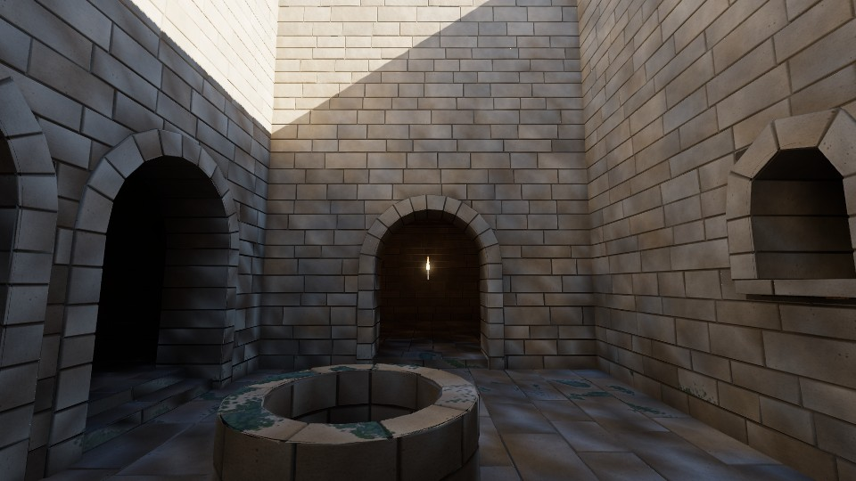
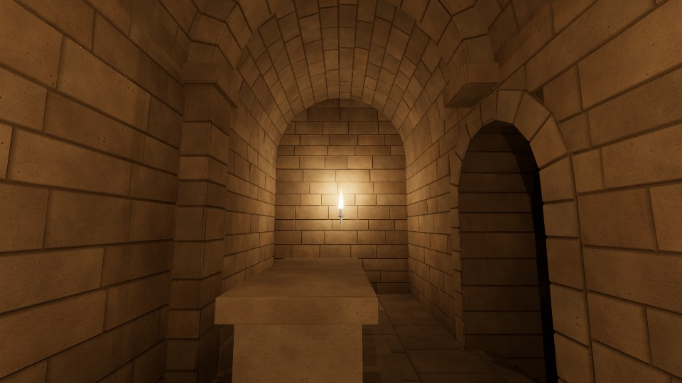
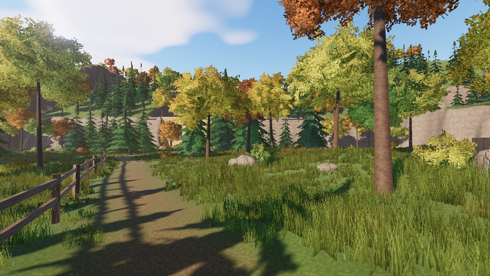
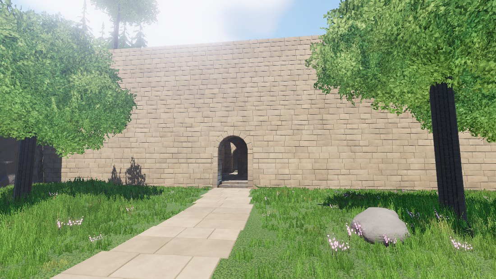
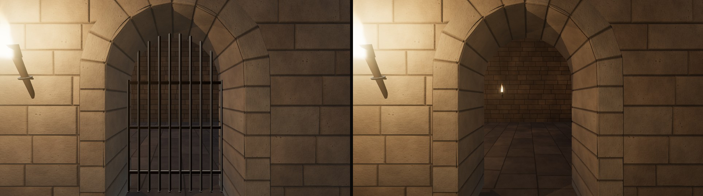

# Dungeons

A browser tool for generating places for adventure and exploring them: a 3D world in WebGL, 2D maps, and data a game can use.

"Dungeon" here means any bounded place worth exploring: crypts and caverns, castles, towns, and locations in open country.

The project is at an early stage. The design is written down in `docs/`. In the browser, each seed generates a small walled house — rooms arranged in loops, sometimes with a court open to the sky — built stone by stone, with procedural materials and baked light. Each has a locked sanctum to reach: keys to find, sometimes a second lock, sometimes a door barred from its far side or a portcullis with a lever beyond it, and a map that fills in as you explore. Every generated place is proven completable before it is shown.

A generated place (seed `check-0`): its cloister court, its sanctum, and its plan.





Four seeds, four plans: a ring round a court, two rings side by side, two rings one behind the other with a court to cross, and rooms off a central gallery. Stars mark the sanctum, diamonds the keys, coloured strokes the locked doors; shaded rooms are unlit.


The same place can be exported as a map drawn in ink, with everything a referee needs marked on it:


Or as a battle map: the built world itself from straight above, roofs cut away, ruled in 1.5 metre squares:


You arrive outdoors at the far end of a valley, and walk up through woods to the meadow below the house. The whole valley can be walked, out to a rim of rock; hills and mountains lie beyond:


Valleys differ from one place to the next in size and season, and in what they hold for whoever walks that far: a ring of standing stones on a rise, a pond with a landing stage, the ruin of a stone hut.







Some houses hide a chamber behind a stretch of wall that is really a door:


Rooms have uses and are furnished for them, and a forsaken house has lost a roof:


Some ways are shut by a portcullis, raised by a lever on the far side. You can see through it to where you cannot yet go:



Each place has its own stone and time of day:


Some dead ends are natural caves, unlit, walled off behind a door:


The hand-built scene used to develop the look (`?scene=test`):


More in `docs/images/`. All were captured from the running program.

## Running it

```
npm install
npm run dev
```

Open the address Vite prints.

- **Mouse and keyboard:** click to walk; `W` `A` `S` `D` to move, `Shift` to run, `Space` to jump, `L` raises or lowers the light you carry, `M` enlarges the map, `G` reveals the whole map, `F` toggles fog, `B` toggles baked light.
- **Touch:** drag on the left side of the screen to move (a thumb stick appears under your finger; push well past its rim to run), drag on the right side to look, and use the buttons to jump and to raise or lower your light.

Doors and keys need no button: walk up to a door to try it, walk up to a key to take it, and reach the chest in the sanctum to finish.

Each place has its seed in the address, so a link reproduces it; **New place** rolls another, and **Gallery** shows a dozen candidates at a time as plans to choose from. Some rooms are dark on purpose; they are shaded on the map.

An opening card names the place, shows the controls for your device, and offers three levels of detail; the choice is remembered. Touch devices start on Medium.

Useful URL parameters: `quality` (`low`, `medium` or `high`), `grass` (how far off grass is drawn, in metres), `nointro` (skip the opening card), `seed` (any text), `scene=test` (the hand-built courtyard and hall used to develop the look), `rays` and `bounces` (bake quality; defaults 32 and 2), `nobake`, `tex` (texture size), `dpr` (pixel ratio cap).

**Export** saves the current place: its plan and an ink map as images with a key to the rooms, a battle map rendered from above, its site document as JSON, and its 3D model as a glTF file (`.glb`, about 50 MB for a ten-room place; baked light is not included). [The site format](docs/05-site-format.md) describes all of them. `examples/viewer/` is a small page, published beside the tool, that loads an exported model and its document and shows the building cut open with its rooms named.

Checks that drive the real program in a headless browser are in [`tools/browser`](tools/browser/README.md). To check the generator without a browser: `npx tsx tools/sites.ts 300` generates 300 sites and reports on them, and `npx tsx tools/furnish.ts <seed>` reports how each room was furnished. `npm run range` measures 2,000 sites and writes [a report of what the generator makes](public/range.html), which is published beside the tool as `range.html`.

## Publishing

Every push to the default branch is built by GitHub Actions and written to the `gh-pages` branch (`.github/workflows/pages.yml`). To serve it, set Settings > Pages > Source to "Deploy from a branch", branch `gh-pages`, folder `/ (root)`. That is a one-time step.

## The idea in brief

A fantastic site is a place with a past, a shape you can learn and a rhythm you can feel. Generators usually get local detail right and global intent wrong, so this one works top-down:

1. Decide what the place is: who built it, what happened to it, who lives there now, and where it sits in the landscape.
2. Decide what the player does: a structure of nested loops, locks and keys, shortcuts and reveals.
3. Lay that structure out in space, with height, and shape the terrain and walls to hold it.
4. Give each district a biome that changes how the player moves, sees and thinks.
5. Build it, break it, move in: construct, apply history, then populate.
6. Light it deliberately and let its history show on every surface.
7. Verify it can be completed, measure how good it is, and keep the best of many.

## Documents

- [1. What makes it fantastic](docs/01-what-makes-it-fantastic.md) — design principles for sites and biomes, and the tests output is judged by
- [2. How to generate it](docs/02-generation.md) — the pipeline, site grammars, the data model and the quality model
- [3. The tool and the plan](docs/03-plan.md) — what gets built, technology, milestones, risks and decisions
- [4. The look](docs/04-look.md) — geometry, materials, lighting, performance and 2D map styles
- [5. The site format](docs/05-site-format.md) — what the tool exports and how to use it elsewhere
