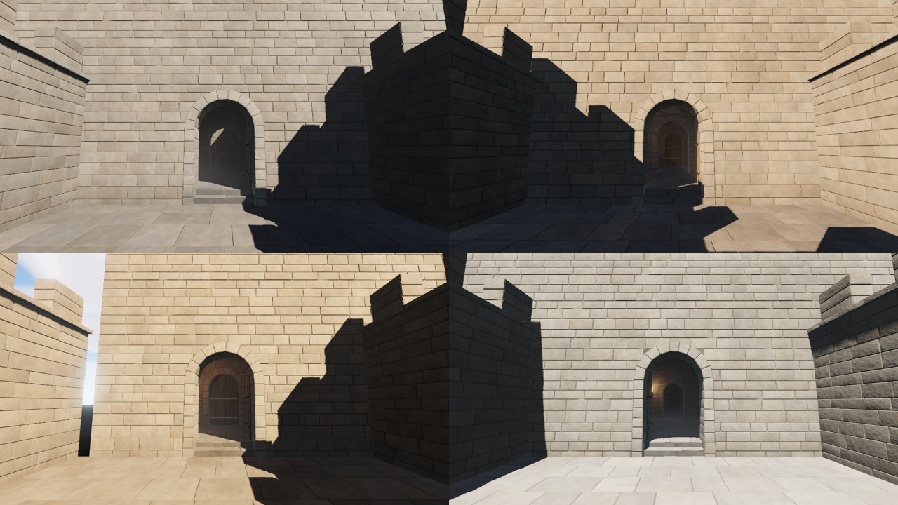
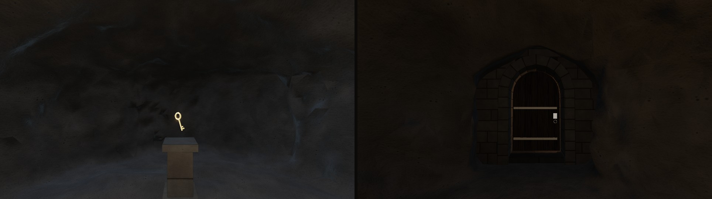
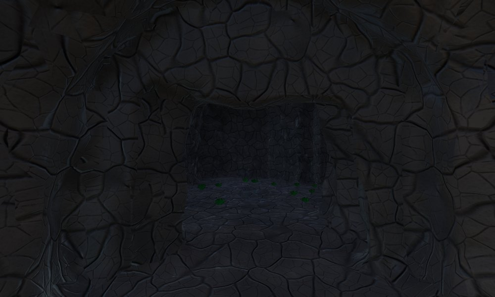
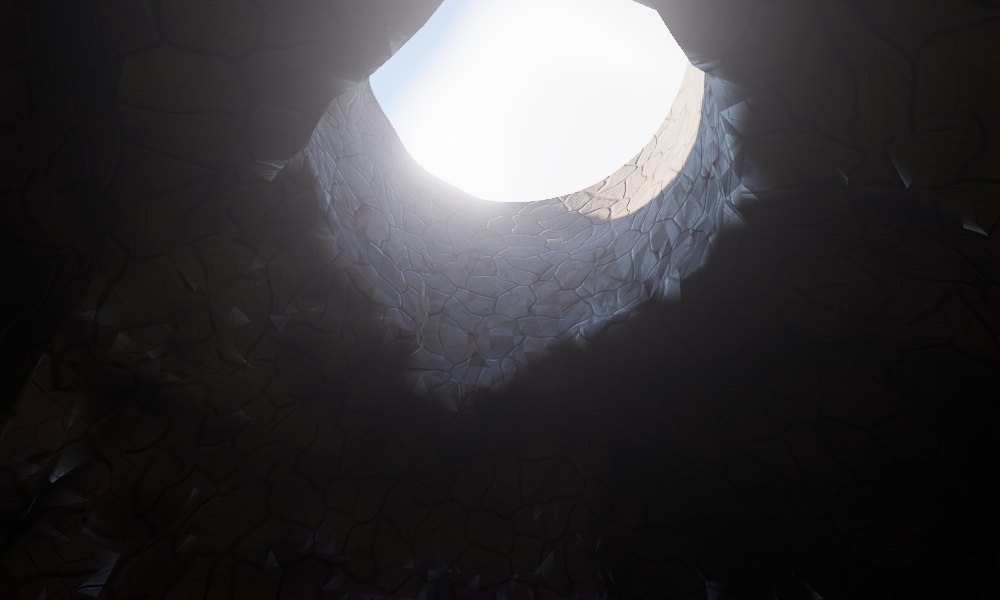

# Dungeons

A browser tool for generating places for adventure and exploring them: a 3D world drawn with WebGPU (or WebGL 2 where a browser has no WebGPU), 2D maps, and data a game can use.

"Dungeon" here means any bounded place worth exploring: crypts and caverns, castles, towns, and locations in open country.

The project is at an early stage. The design is written down in `docs/`. In the browser, each seed generates a small walled house — rooms arranged in loops, sometimes with a court open to the sky — built stone by stone, with procedural materials and baked light. Each has a locked sanctum to reach: keys to find, sometimes a second lock, sometimes a door barred from its far side or a portcullis with a lever beyond it, and a map that fills in as you explore. Every generated place is proven completable before it is shown.

A generated place (seed `check-0`): its cloister court, its sanctum, and its plan.


Four seeds, four plans: a ring round a court, two rings side by side, two rings one behind the other with a court to cross, and rooms off a central gallery. Stars mark the sanctum, diamonds the keys, coloured strokes the locked doors; shaded rooms are unlit.


The same place can be exported as a map drawn in ink, with everything a referee needs marked on it:


Or as a battle map: the built world itself from straight above, roofs cut away, ruled in 1.5 metre squares:


You arrive outdoors at the far end of a valley, and walk up through woods to the meadow below the house. The whole valley can be walked, out to a rim of rock; hills and mountains lie beyond:


Valleys differ from one place to the next in size and season, and in what they hold for whoever walks that far: a ring of standing stones on a rise, a pond with a landing stage, the ruin of a stone hut.


What grows is placed by rule, from shade, moisture, wear and soil: ferns under the trees, tall herbs in damp open ground, bushes at the edge of the wood, nettles about a ruin, and grass that is long where nobody walks.


Some houses hide a chamber behind a stretch of wall that is really a door:


Rooms have uses and are furnished for them, and a forsaken house has lost a roof:


Some ways are shut by a portcullis, raised by a lever on the far side. You can see through it to where you cannot yet go:


Each place has its own stone and time of day:



Some dead ends are natural caves, unlit, walled off behind a door:



A cave may run on through several chambers, dark and lit by turns: daylight from a hole in the roof, or growths that glow.





The hand-built scene used to develop the look (`?scene=test`):


More in `docs/images/`. All were captured from the running program.

## Running it

```
npm install
npm run dev
```

Open the address Vite prints.

- **Mouse and keyboard:** click to walk; `W` `A` `S` `D` to move, `Shift` to run, `Space` to jump, `V` to fly (no weight and nothing solid: you move the way you look, `Space` rises, `C` sinks, `Shift` goes fast; `V` again drops you where you are), `L` raises or lowers the light you carry, `N` turns sound on or off, `M` enlarges the map, `G` reveals the whole map, `F` toggles fog, `B` toggles baked light.
- **Touch:** drag on the left side of the screen to move (a thumb stick appears under your finger; push well past its rim to run), drag on the right side to look, and use the buttons to jump and to raise or lower your light.

Doors and keys need no button: walk up to a door to try it, walk up to a key to take it, and reach the chest in the sanctum to finish.

Each place has its seed in the address, so a link reproduces it; **New place** rolls another, **An island** (or, on an island, **A valley**) rolls one of the other kind, and **Gallery** shows a dozen candidates at a time as plans to choose from (islands among them, drawn whole). Some rooms are dark on purpose; they are shaded on the map.

An opening card names the place, shows the controls for your device, and offers three levels of detail; the choice is remembered. Touch devices start on Medium.

Useful URL parameters: `quality` (`low`, `medium` or `high`), `grass` (how far off grass is drawn, in metres), `leaves` (the share of leaf cards drawn on trees, 0 to 1), `blades` (`blades=0` draws grass as painted tufts at every distance; by default it is real blades within 15 metres and tufts beyond), `agemix` (every age of broadleaf in turn, for looking at), `treerow=x,z` (a row of each kind of broadleaf standing alone from that point, seven metres apart along x, with no woods), `leafcut` (how dense a leaf card must be to cast shadow, 0.42 to 1; 0.7 by default, and higher lets more sun through crowns), `nointro` (skip the opening card), `fly` (start in the air, flying), `hour` (`morning`, `midday`, `evening`, `sunset`, `dusk` or `night`, whatever the seed gave), `cloud` (how much of the sky is cloud, 0 to 1), `layered` (cloud in flat banks; `layered=0` for heaped), `mist` and `haze` (how much mist lies in the low ground and how thick the air is with distance, each 0 to 1), `clouds` (steps taken through the clouds; 0 turns them off), `mirror` (the size in pixels of the picture still water reflects; 0 and it mirrors the sky alone), `seed` (any text; any of these may also be given after a `#` instead of a `?`, which is how a page shown inside another, as in an embedded preview, keeps them; a build made with `VITE_PLACE=island npm run build` opens on an island when nothing is asked for), `place=island` (an island in the sea instead of a valley: the same house for the same seed, on high ground over sea cliffs, with a cove, a fishing hamlet, a lighthouse and now and then a castle), `scene=test` (the hand-built courtyard and hall used to develop the look), `rays` and `bounces` (bake quality; defaults 32 and 2), `nobake`, `tex` (texture size), `dpr` (pixel ratio cap), `webgl` (draw with WebGL 2 even where WebGPU is to be had), `wind` (how hard the wind blows in what grows, 1 by default), `at` (`x,y,z,yaw`: start standing there; the weather menu uses it to put you back after a change of hour).

In play, **Weather** opens a menu: cloud, whether it heaps up or lies in banks, mist, haze and wind change as you watch; a new time of day builds the place again and puts you back where you stood. What it changes is kept in the address, so a reload brings it back.

**Export** saves the current place: its plan and an ink map as images with a key to the rooms, a battle map rendered from above, its site document as JSON, and its 3D model as a glTF file (`.glb`, about 50 MB for a ten-room place; baked light is not included). [The site format](docs/05-site-format.md) describes all of them. `examples/viewer/` is a small page, published beside the tool, that loads an exported model and its document and shows the building cut open with its rooms named.

Checks that drive the real program in a headless browser are in [`tools/browser`](tools/browser/README.md). To check the generator without a browser: `npx tsx tools/sites.ts 300` generates 300 sites and reports on them, and `npx tsx tools/furnish.ts <seed>` reports how each room was furnished, and `npx tsx tools/land.ts 12` builds the valley and its rock for twelve seeds and reports rock in the doorway, bad numbers and how long each took. `npx tsx tools/island.ts 4` does the same for islands, and also counts what was planted and how many fences keep the player from the cliffs and the sea. `tools/sites.ts` checks a quarter as many islands as valleys. `npm run range` measures 2,000 sites and writes [a report of what the generator makes](public/range.html), which is published beside the tool as `range.html`.

## The material lab

```
npm run lab
```

opens `lab/materials.html`: a small stage apart from the game, for working on how rock, ground and leaves are drawn. On it stand a cliff in towers of unequal height, with bays, clefts and an end that lies back, behind it a mountain of the same stone some eighty-five metres high (carved coarsely, so that all but its great forms is the material's doing), a row of boulders from a hand's breadth to a cottage, a patch of ground with a cart track, a footpath and a wet hollow, an oak, an ash, an old spreading oak, a spruce, a pine and a bush, and grass, flowers, ferns and reeds. All of it is made by the game's own carving and planting and drawn with the game's own materials, renderer, air and exposure, so what is seen there is what a valley will show. It builds in about two seconds.

- **Saving swaps.** Save `src/render/siteMaterial.ts`, `vegetation.ts` or `textures.ts` and the new materials are put on where they stand, in a fraction of a second, with the camera and every setting as they were. What went wrong, if something did, is written at the foot of the page, and the old materials stay. (Saving anything else loads the page again, which takes two or three seconds and also keeps the camera and the settings.)
- **Keep a picture** (`K`), change something, and drag the line across the view: the kept picture on its left, the live one on its right. `B` goes back to where the picture was taken, `X` lets it go. Untick *exposure follows* first when comparing how bright two versions are, or the eye's adjustment hides the difference.
- **Views** on the keys shown on their buttons: the stage, the mountain and its face, the cliff near, close and from 230 metres through a long lens, the boulders, the track at walking height and from a stride away, far ground, the oak, its leaves, the oak against the sun, the hollow, the firs. Drag to turn, wheel to close in, right-drag to slide, double click a point to turn about it, `G` to stand at eye height where the camera is, and the *Lens* slider to look at far things large.
- **Sliders** for the hour and where the sun stands, haze, the stone (which carves the stage again), how far rock is lit in flat faces and how water-worn it is, moss and damp, the season, wind, and the texture size. *Clay* (`C`) draws everything solid in one grey, to tell what the shapes give from what the materials give. `P` hides the panel.
- In the address: `stone`, `season`, `hour`, `tex`, `view` (a view's key or name), `still` (no wind), `webgl`. From the console, `__lab` has `view(name)`, `place(from, to, lens)`, `capture()` (a promise of a picture) and the state.

It is for development and is not part of what is published. (`lab/rock-lab.html` is an older page of the same kind, with materials of its own that the game does not use.)

## Publishing

Every push to the default branch is built by GitHub Actions and written to the `gh-pages` branch (`.github/workflows/pages.yml`). To serve it, set Settings > Pages > Source to "Deploy from a branch", branch `gh-pages`, folder `/ (root)`. That is a one-time step.

## The idea in brief

A fantastic site is a place with a past, a shape you can learn and a rhythm you can feel. Generators usually get local detail right and global intent wrong, so this one works top-down:

1. Decide what the place is: who built it, what happened to it, who lives there now, and where it sits in the landscape.
2. Decide what the player does: a structure of nested loops, locks and keys, shortcuts and reveals.
3. Lay that structure out in space, with height, and shape the terrain and walls to hold it.
4. Give each district a biome that changes how the player moves, sees and thinks.
5. Build it, break it, move in: construct, apply history, then populate.
6. Light it deliberately and let its history show on every surface.
7. Verify it can be completed, measure how good it is, and keep the best of many.

## Documents

- [1. What makes it fantastic](docs/01-what-makes-it-fantastic.md) — design principles for sites and biomes, and the tests output is judged by
- [2. How to generate it](docs/02-generation.md) — the pipeline, site grammars, the data model and the quality model
- [3. The tool and the plan](docs/03-plan.md) — what gets built, technology, milestones, risks and decisions
- [4. The look](docs/04-look.md) — geometry, materials, lighting, performance and 2D map styles
- [5. The site format](docs/05-site-format.md) — what the tool exports and how to use it elsewhere
