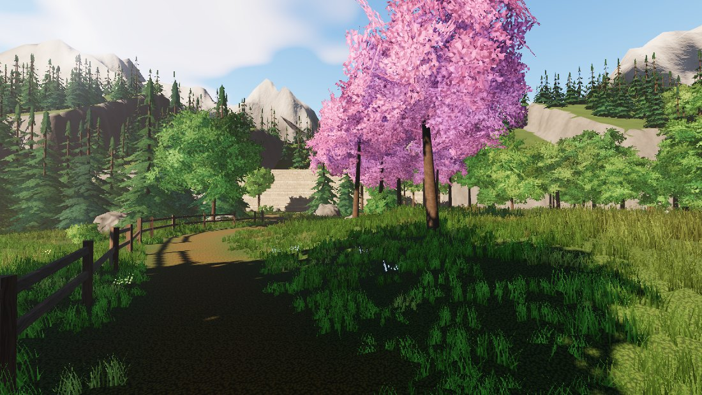
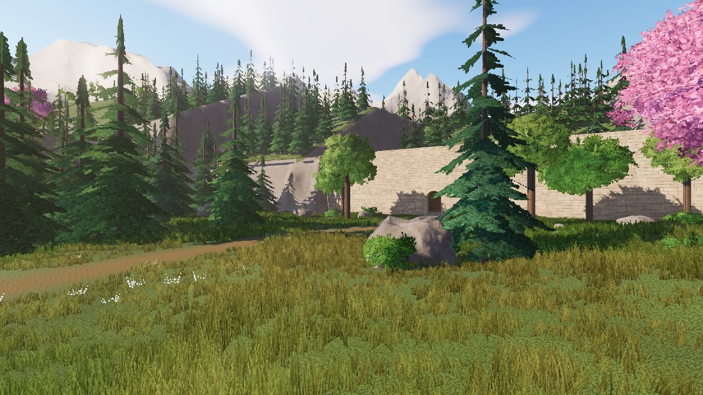
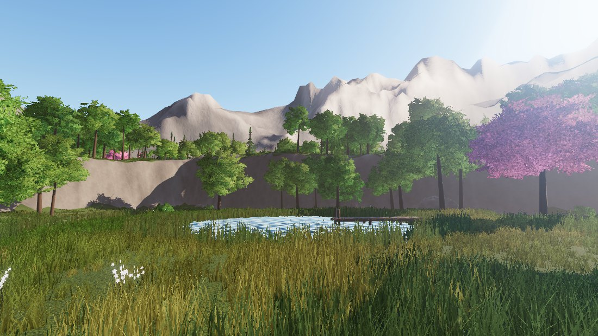
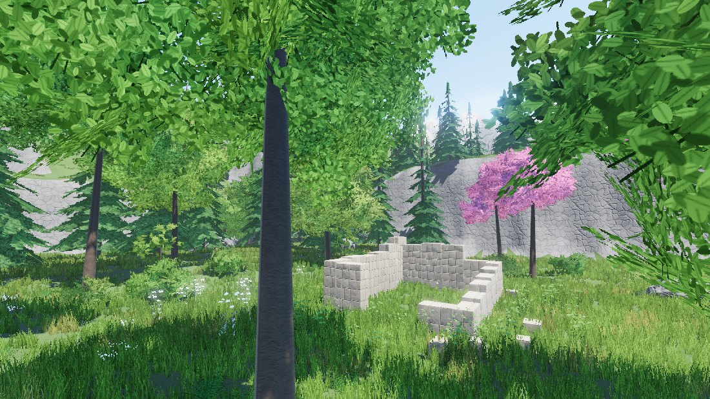
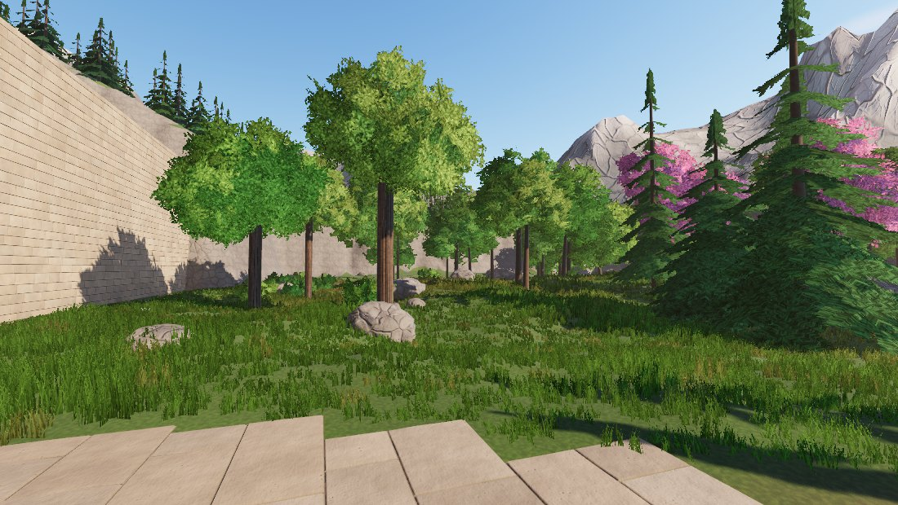
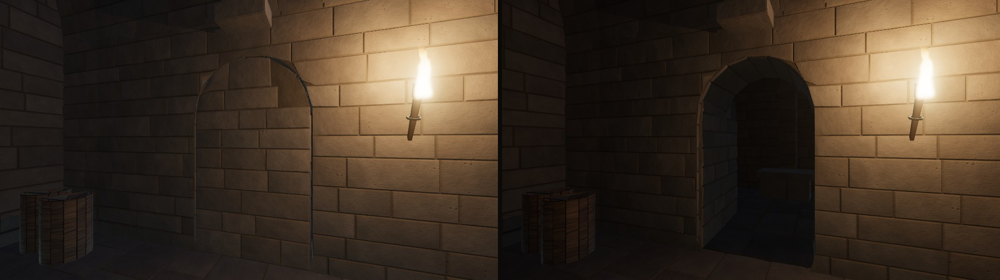
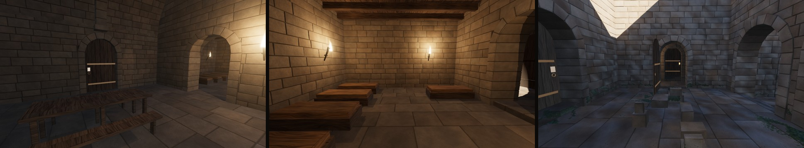
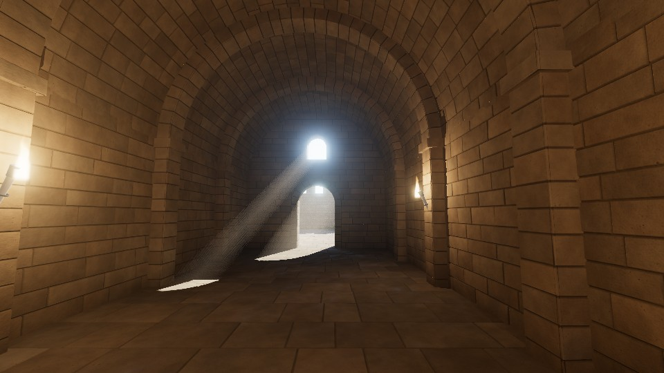

# Dungeons

A browser tool for generating places for adventure and exploring them: a 3D world drawn with WebGPU (or WebGL 2 where a browser has no WebGPU), 2D maps, and data a game can use.

"Dungeon" here means any bounded place worth exploring: crypts and caverns, castles, towns, and locations in open country.

The project is at an early stage. The design is written down in `docs/`. In the browser, each seed generates a small walled house — rooms arranged in loops, sometimes with a court open to the sky — built stone by stone, with procedural materials and baked light. Each has a locked sanctum to reach: keys to find, sometimes a second lock, sometimes a door barred from its far side or a portcullis with a lever beyond it, and a map that fills in as you explore. Every generated place is proven completable before it is shown.

A generated place (seed `check-0`): its cloister court, its sanctum, and its plan.


Four seeds, four plans: a ring round a court, two rings side by side, two rings one behind the other with a court to cross, and rooms off a central gallery. Stars mark the sanctum, diamonds the keys, coloured strokes the locked doors; shaded rooms are unlit.


The same place can be exported as a map drawn in ink, with everything a referee needs marked on it:


Or as a battle map: the built world itself from straight above, roofs cut away, ruled in 1.5 metre squares:


You arrive outdoors at the far end of a valley, and walk up through woods to the meadow below the house. The whole valley can be walked, out to a rim of rock; hills and mountains lie beyond:





Valleys differ from one place to the next in size and season, and in what they hold for whoever walks that far: a ring of standing stones on a rise, a pond with a landing stage, the ruin of a stone hut.




What grows is placed by rule, from shade, moisture, wear and soil: ferns under the trees, tall herbs in damp open ground, bushes at the edge of the wood, nettles about a ruin, and grass that is long where nobody walks.






Some houses hide a chamber behind a stretch of wall that is really a door:



Rooms have uses and are furnished for them, and a forsaken house has lost a roof:



Some ways are shut by a portcullis, raised by a lever on the far side. You can see through it to where you cannot yet go:


Each place has its own stone and time of day:


Some dead ends are natural caves, unlit, walled off behind a door:


A cave may run on through several chambers, dark and lit by turns: daylight from a hole in the roof, or growths that glow.


The hand-built scene used to develop the look (`?scene=test`):



More in `docs/images/`. All were captured from the running program.

## Running it

```
npm install
npm run dev
```

Open the address Vite prints.

- **Mouse and keyboard:** click to walk; `W` `A` `S` `D` to move, `Shift` to run, `Space` to jump, `V` to fly (no weight and nothing solid: you move the way you look, `Space` rises, `C` sinks, `Shift` goes fast; `V` again drops you where you are), `L` raises or lowers the light you carry, `N` turns sound on or off, `M` enlarges the map, `G` reveals the whole map, `F` toggles fog, `B` toggles baked light, `H` hides the interface (for pictures; `?nogui` starts with it hidden).
- **Touch:** drag on the left side of the screen to move (a thumb stick appears under your finger; push well past its rim to run), drag on the right side to look, and use the buttons to jump and to raise or lower your light.

Doors and keys need no button: walk up to a door to try it, walk up to a key to take it, and reach the chest in the sanctum to finish.

Each place has its seed in the address, so a link reproduces it; **New place** rolls another, the next button rolls another kind of place (from a valley **An island**, from an island **A mountain**, from a mountain **A valley**), and **Gallery** shows a dozen candidates at a time as plans to choose from (islands and mountain tops among them, drawn whole). Some rooms are dark on purpose; they are shaded on the map.

An opening card names the place, shows the controls for your device, and offers three levels of detail; the choice is remembered. Touch devices start on Medium.

Useful URL parameters: `quality` (`low`, `medium` or `high`), `grass` (how far off grass is drawn in full, in metres; beyond that one tuft in four is still drawn, broader, out to two and a half times as far), `leaves` (the share of leaf cards drawn on trees, 0 to 1), `blades` (`blades=0` draws grass as painted tufts at every distance; by default it is real blades within 15 metres and tufts beyond, the two giving way to each other tuft by tuft over the outer half of that), `agemix` (every age of broadleaf in turn, for looking at), `treerow=x,z` (a row of each kind of broadleaf standing alone from that point, seven metres apart along x, with no woods), `sprigs` (`sprigs=0` draws the leaves of near trees as painted sprays on cards, as far ones are; by default trees within 26 metres have leaves made one by one, and conifers needles shoot by shoot), `leafcut` (how dense a leaf card must be to cast shadow, 0.42 to 1; 0.7 by default, and higher lets more sun through crowns), `nointro` (skip the opening card), `fly` (start in the air, flying), `hour` (`morning`, `midday`, `evening`, `sunset`, `dusk` or `night`, whatever the seed gave), `cloud` (how much of the sky is cloud, 0 to 1), `layered` (cloud in flat banks; `layered=0` for heaped), `mist` and `haze` (how much mist lies in the low ground and how thick the air is with distance, each 0 to 1), `clouds` (steps taken through the clouds; 0 turns them off), `mirror` (the size in pixels of the picture still water reflects; 0 and it mirrors the sky alone), `seed` (any text; any of these may also be given after a `#` instead of a `?`, which is how a page shown inside another, as in an embedded preview, keeps them; a build made with `VITE_PLACE=island npm run build` opens on an island when nothing is asked for), `place=island` (an island in the sea instead of a valley: the same house for the same seed, on high ground over sea cliffs, with a cove, a fishing hamlet, a lighthouse and now and then a castle), `place=town` (a harbour town on a coast between the sea and the mountains instead: the same house on a terrace at the head of the town's market square, a harbour with a quay, moles and a light, where the player arrives, streets of classical, timber-framed and wooden houses, shacks and red storehouses along the shore, fields, woods, and an outlook on the headland), `place=mountain` (a mountain top above a sea of cloud instead: the same house as a hospice in a saddle under the summit, a ridge coming up out of the cloud where the player arrives, a path winding up a ridge to the summit's cairn, summer or winter), `settle` (`town`, `village`, `hamlet`, `manor` or `none`: the settlement a valley has, whatever the seed gave it, where there is room; `settle=town` gives a street of brick houses in the manner of the Baltic towns, with a church of brick), `world` and `n` (`world=w2&n=2`: the house built on the second valley head that world holds, or with `place=island` its second island; the land is the world's, made first in a worker, half a minute, and the hills about the place are the world's own out to three kilometres; the house is still the seed's own, with `place=mountain` a hospice on the world's summit, the top drawn on it and the world all about, and with `place=town` the harbour town on the world's coastal town, its land the world's, where a stream comes down to the world's shore; see `docs/06-world.md`. The world page, `world.html`, lists each world's places with links to them), `terrain=plain` (the land as places were first made: drawn by rule. By default a valley is found in an upland made by noise and worn, and its sides read off that land; an island is found in a sea of islands made by noise and worn by simulated water and frost, and only what the game needs is cut into it; a mountain top's shape is worn the same way, and the country round about made so; a site takes a few seconds more to make), `snow` (how much snow lies, 0 to 1, whatever the season), `sheet` (how finely a valley's walked ground is laid: the cell of its sheet in metres, 1.2 by default; `sheet=0.8` lays it finer, the rock along its sides then carved at 0.267 metres instead of 0.3, and costs about a fifth more building and a third more triangles of ground), `scene=test` (the hand-built courtyard and hall used to develop the look), `rays` and `bounces` (bake quality; defaults 32 and 2), `nobake`, `tex` (texture size), `dpr` (pixel ratio cap), `tiles` (how large, in metres, the tiles are that what lies beyond the site is cut into so that what is out of view is not drawn; 64 by default, `tiles=0` for one mesh to a material), `webgl` (draw with WebGL 2 even where WebGPU is to be had), `wind` (how hard the wind blows in what grows, 1 by default), `at` (`x,y,z,yaw`: start standing there; the weather menu uses it to put you back after a change of hour).

In play, **Weather** opens a menu: cloud, whether it heaps up or lies in banks, mist, haze, wind and rain change as you watch (`?rain=0.8` starts it raining); a new time of day builds the place again and puts you back where you stood. What it changes is kept in the address, so a reload brings it back.

**World** (`world.html`, published beside the tool) makes a whole country six kilometres by ten from a seed (`?world=<seed>`; `?size=8x8` for another size): a sea with islands to the south, a coast with a bay and fjords, low country of fields and woods, an upland of glens and a range of mountains up to 800 metres to the north, with rivers, towns and the roads, tracks, paths and ferries between them. The islands, valley heads and mountain tops a house could stand on are found in it (up to four of each, as many as the land holds), each house's ground fitted to the land, levelled or terraced, and marked in red on an ink map in the style of the place's own, with a key and a list of them; **Relief** shows it as shaded relief. It takes half a minute or less. The places cannot yet be walked from it: [the plan](docs/06-world.md) says how they will be, with the land streamed in at a metre where it is walked. **Walk** (`walk.html?world=<seed>`) walks a world's land, streamed in a square of 256 metres at a time at a metre, in workers, nearest first, each meshed only as finely as how far off it lies calls for, and drawn as the game draws: its ground and rock materials from what the world says lies at each point, grass and flowers about the walker, trees in the woods (whole near by, painted far off), its sky, sun and haze. Two menus choose the world and the place to go to, and **Build a house here** opens the game on that place; `P` goes on to the next place, `1` to `4` to the valley heads (with Shift the islands), `V` flies (Space up, `C` down), `M` shows the triangles. On a phone or tablet: a thumb stick wherever the left of the screen is touched (push it far to run), drag on the right to look, and buttons to fly, rise, sink and go to the next place. The box **Half-metre ground** (or `?fine`) lays the ground within 150 metres of you at half a metre, with tussocks, stones and rills, which the land at a metre does not have; the browser remembers it. `?hour=`, `?season=`, `?haze=`, `?tex=`. Lakes, rivers, roads and the places' houses are not on it yet.

**Export** saves the current place: its plan and an ink map as images with a key to the rooms (the ink map with a second sheet of the whole valley, island or mountain top), a battle map rendered from above, its site document as JSON, and its 3D model as a glTF file (`.glb`, about 50 MB for a ten-room place; baked light is not included). [The site format](docs/05-site-format.md) describes all of them. `examples/viewer/` is a small page, published beside the tool, that loads an exported model and its document and shows the building cut open with its rooms named.

Checks that drive the real program in a headless browser are in [`tools/browser`](tools/browser/README.md). To check the generator without a browser: `npx tsx tools/sites.ts 300` generates 300 sites and reports on them, and `npx tsx tools/furnish.ts <seed>` reports how each room was furnished, and `npx tsx tools/land.ts 12` builds the valley and its rock for twelve seeds and reports rock in the doorway, bad numbers, how long each took and how many triangles of rock and of ground it made (`SHEET=0.8` before it lays the ground finer, as `?sheet=0.8` does). `npx tsx tools/island.ts 4` does the same for islands, and also counts what was planted and how many fences keep the player from the cliffs and the sea. `npx tsx tools/mountain.ts 4` does the same for mountain tops (`npx tsx tools/mountain.ts 4 peak plain` for plain ones), and `npx tsx tools/terrain.ts 3 peak <folder> 1.5` draws each mountain's land as shaded relief, plain beside worn, as PNG files (`top` after the scale draws only the top, larger; `country` the country round about, fourteen kilometres across, or as far as a last number says), and `npx tsx tools/islandRelief.ts <folder> 1 isle0 isle1` does the same for islands, drawn beside found. `tools/sites.ts` checks a quarter as many islands, and as many mountain tops, as valleys, and a twentieth as many plain mountain tops; with `valley`, `island` or `mountain` after the count it checks that kind alone (the whole now takes some twenty minutes). `npx tsx tools/world.ts 3 <folder>` builds three worlds without a browser, reports what was found in each and how long it took, and draws each as shaded relief. `npm run range` measures 2,000 sites and writes [a report of what the generator makes](public/range.html), which is published beside the tool as `range.html`.

## The material lab

```
npm run lab
```

opens `lab/materials.html`: a small stage apart from the game, for working on how rock, ground and leaves are drawn. On it stand a cliff in towers of unequal height, with bays, clefts and an end that lies back, behind it a mountain of the same stone some eighty-five metres high (carved coarsely, so that all but its great forms is the material's doing), a row of boulders from a hand's breadth to a cottage, a patch of ground with a cart track, a footpath and a wet hollow, an oak, an ash, an old spreading oak, a spruce, a pine, a pine of the coast and a bush, and grass, flowers, ferns and reeds. All of it is made by the game's own carving and planting and drawn with the game's own materials, renderer, air and exposure, so what is seen there is what a valley will show. It builds in about two seconds.

- **Saving swaps.** Save `src/render/siteMaterial.ts`, `vegetation.ts` or `textures.ts` and the new materials are put on where they stand, in a fraction of a second, with the camera and every setting as they were. What went wrong, if something did, is written at the foot of the page, and the old materials stay. (Saving anything else loads the page again, which takes two or three seconds and also keeps the camera and the settings.)
- **Keep a picture** (`K`), change something, and drag the line across the view: the kept picture on its left, the live one on its right. `B` goes back to where the picture was taken, `X` lets it go. Untick *exposure follows* first when comparing how bright two versions are, or the eye's adjustment hides the difference.
- **Views** on the keys shown on their buttons: the stage, the mountain and its face, the cliff near, close and from 230 metres through a long lens, the boulders, the track at walking height and from a stride away, far ground, the oak, its leaves, the oak against the sun, the hollow, the firs. Drag to turn, wheel to close in, right-drag to slide, `W` `A` `S` `D` to fly the way the camera looks and sideways (Space rises, `Q` sinks, Shift goes four times as fast), double click a point to turn about it, `G` to stand at eye height where the camera is, and the *Lens* slider to look at far things large.
- **Sliders** for the hour and where the sun stands, haze, the stone (which carves the stage again), how far rock is lit in flat faces and how water-worn it is, moss and damp, the season, wind, how tall the grass stands and how unequal it is, and the texture size. *Clay* (`C`) draws everything solid in one grey, to tell what the shapes give from what the materials give. `P` hides the panel.
- **The land brush** (`L`, or *brush in hand*): a ball on the pointer. Drag with the left button and it lays a trail of rock on whatever the pointer meets: the ground, the cliff, the mountain, or what was just painted, so a mass can be built upward. Let go and the whole is carved, of the stage's stone and broken as its cliff is, in a second or less; the bigger the mass the coarser it is carved. `[` and `]` change the brush's size (0.4 to 40 metres), Shift or *dig* bites out of what was painted, `Z` undoes a stroke, *Clear* removes all of it. With the brush in hand the right button turns the view. Painted land is remembered while the tab is open, and is carved again in the new stone when the stone is changed. It cannot dig into the stage's own cliff, mountain or ground. *Paints* chooses what the brush lays: rock, or plants: oak, ash, pine, coast pine, spruce, bush, a mixed wood, grass, flowers or ferns. Plants are scattered within the brush as you drag, on the stage's land or on land you painted, trees keeping their distance from one another, and grown when you let go (a wood of forty trees in well under a second); digging with a plant brush takes away what was painted under it, and *Clear plants* all of it.
- In the address: `stone`, `season`, `hour`, `tex`, `view` (a view's key or name), `still` (no wind), `webgl`. From the console, `__lab` has `view(name)`, `place(from, to, lens)`, `capture()` (a promise of a picture), `growPlants()` (grows again what `state.dabs` says, for planting from a script) and the state.

It is for development and is not part of what is published. (`lab/rock-lab.html` is an older page of the same kind, with materials of its own that the game does not use.)

`lab/buildings.html`, on the same server (`npm run dev`, then that address), shows buildings made by the game's own generator, lit plainly by a sun and a sky, for judging their shapes. With nothing in the address it deals a row of classical buildings their variations as a place deals them (the heights of their storeys, an L or a U, a middle without its pediment, towers at the corners, a carriage way, more than one entrance) and names what each got; `?bays=11&wings=2&towers=3&extra=2&pediment=0` builds one as asked (`storeys`, `heights=4.8,3.3,3.3`, `arch=-1` or `1` for a carriage way at that end, `entrances=3,9` for doors in those bays, `length` of the wings, `turn` in degrees, `seed` too), and `?style=timber` a row of timber houses. Drag to turn about it.

## Publishing

Every push to the default branch is built by GitHub Actions and written to the `gh-pages` branch (`.github/workflows/pages.yml`). To serve it, set Settings > Pages > Source to "Deploy from a branch", branch `gh-pages`, folder `/ (root)`. That is a one-time step.

## The idea in brief

A fantastic site is a place with a past, a shape you can learn and a rhythm you can feel. Generators usually get local detail right and global intent wrong, so this one works top-down:

1. Decide what the place is: who built it, what happened to it, who lives there now, and where it sits in the landscape.
2. Decide what the player does: a structure of nested loops, locks and keys, shortcuts and reveals.
3. Lay that structure out in space, with height, and shape the terrain and walls to hold it.
4. Give each district a biome that changes how the player moves, sees and thinks.
5. Build it, break it, move in: construct, apply history, then populate.
6. Light it deliberately and let its history show on every surface.
7. Verify it can be completed, measure how good it is, and keep the best of many.

## Documents

- [1. What makes it fantastic](docs/01-what-makes-it-fantastic.md) — design principles for sites and biomes, and the tests output is judged by
- [2. How to generate it](docs/02-generation.md) — the pipeline, site grammars, the data model and the quality model
- [3. The tool and the plan](docs/03-plan.md) — what gets built, technology, milestones, risks and decisions
- [4. The look](docs/04-look.md) — geometry, materials, lighting, performance and 2D map styles
- [5. The site format](docs/05-site-format.md) — what the tool exports and how to use it elsewhere
- [6. The world](docs/06-world.md) — one country holding every kind of place, its map, and the plan for joining the places to it
