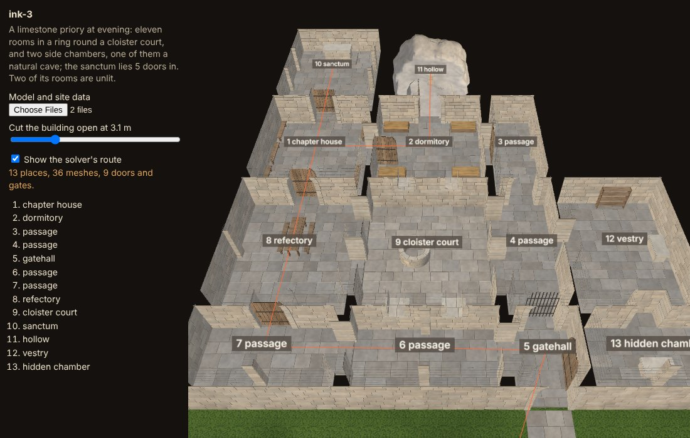

# 5. The site format

What the tool exports, and how to use it somewhere else. This describes **version 1** of the format, which is what the tool writes today.

A generated place leaves the tool as up to four files, all named for the seed:

| File | What it is |
| --- | --- |
| `<seed>.json` | The site document: every place, every way between places, what is locked and what opens it, and a route through. |
| `<seed>.glb` | The built world as a glTF 2.0 model: every stone, with materials. |
| `<seed>-plan.png` | The plan, with a key to the rooms. |
| `<seed>-map.png` | The same plan drawn in ink, as a referee's map. |
| `<seed>-battlemap.jpg` | The built world seen from straight above with the roofs cut away, ruled with a grid. |

The document is the source. The model and the maps are made from it, so they always agree with it and with each other. A game that wants its own look can ignore the model entirely and build from the document; a game that wants the tool's stonework can load the model and use the document to know what it is looking at.

`examples/viewer/` is a small page that does the second of these. It is published beside the tool, at `examples/viewer/`.



## Conventions

- Lengths are in metres.
- Axes are right-handed: **+x is east, +y is up, +z is south.** On the maps north is up the page, so x runs right and z runs down.
- Places, ways and levers are referred to by their index in their arrays. A place's `id` is its index.
- The maps number rooms from 1, so room 4 on a map is `places[3]`.
- Numbers are written to four decimal places.

## The site document

```json
{
  "format": "dungeons-site",
  "version": 1,
  "seed": "ink-3",
  "title": "A limestone priory at evening: eleven rooms in a ring round a cloister court, …",
  "setting": { "stone": "limestone", "hour": "evening", "kind": "priory", "condition": "kept" },
  "sun": [-0.6217, 0.5014, 0.6017],
  "wallThickness": 1,
  "top": 9.2,
  "start": 13, "entrance": 4, "goal": 9, "secret": 12,
  "places": [ … ],
  "ways": [ … ],
  "items": [ … ],
  "levers": [ … ],
  "solution": [ … ]
}
```

| Field | Meaning |
| --- | --- |
| `format`, `version` | Always `"dungeons-site"` and the version number. Check both before reading anything else. |
| `seed` | The seed the site was generated from. The same seed in the same version of the tool gives the same site. |
| `title` | One sentence describing the place. |
| `setting.stone` | `limestone`, `sandstone`, `greystone` or `basalt`. |
| `setting.hour` | `morning`, `midday`, `evening`, `sunset`, `dusk` or `night`. The last three were added later; a reader that knows only the first three can treat them as `evening`. |
| `setting.kind` | What the house is called: priory, abbey and so on. Only a name. |
| `setting.condition` | `kept`, `damp` or `forsaken`. A forsaken house may have lost a roof. |
| `setting.cloud` | How much of the sky is cloud, from 0 (clear) to 1 (overcast). May be absent in older documents. |
| `setting.cloudForm` | `heaped` or `layered`: whether that cloud towers or lies in flat banks. May be absent, which means heaped. |
| `setting.mist` | How much mist lies in the low ground, from 0 (none) to 1 (a morning that cannot be seen across). Mostly when the day is young or done, and more in autumn. May be absent. |
| `setting.haze` | How thick the air is with distance, from 0 (the clearest day) to 1 (hills barely there). May be absent. |
| `setting.season` | `spring`, `summer` or `autumn`. It colours what grows: blossom and fresh green, deeper green and drier grass, or gold, rust and straw. |
| `sun` | Unit vector pointing towards the sun. |
| `wallThickness` | Thickness of the wall between two neighbouring places. |
| `top` | Height of the roofline. Courts are open wells down from it. |
| `grounds` | The open country that can be walked, as `x0`, `x1`, `z0`, `z1`: a valley with the house front along its north side (`z0`). It contains the approach. The player arrives near its south end. Absent if the site has no more than its approach. |
| `track` | The way from the door down the valley, as `[x, z]` points from the door outwards. It is flagged as far as the edge of the approach and a worn track after that. The player arrives at the last point. |
| `features` | Things out in the valley; see below. |
| `streams` | Running water in the valley, if there is any; see below. May be absent. |
| `start` | The place the player starts in. |
| `entrance` | The first room of the house. |
| `goal` | The place to reach. |
| `secret` | A place hidden behind a secret door, or `-1`. |

### Places

A place is a rectangle of open floor. Walls lie outside it.

```json
{ "id": 0, "role": "passage", "name": "chapter house", "roof": "timber", "light": "torch",
  "x0": 0.5, "x1": 7.4, "z0": 14.5, "z1": 22.1, "floor": 0.51, "wall": 4.2, "axis": "z", "depth": 5 }
```

| Field | Meaning |
| --- | --- |
| `x0`, `x1`, `z0`, `z1` | The interior, west to east and north to south. |
| `floor` | Height of the floor. Floors differ from room to room, and steps in the doorways make up the difference. |
| `wall` | Height of the walls above the floor: to where a vault springs, or to a flat ceiling. |
| `roof` | `barrel` (a stone vault), `timber` (boards on beams), `sky` (open), or `cave` (not built: natural rock all round, and the open floor is an irregular hollow inside the rectangle). |
| `axis` | The direction a barrel vault runs, `x` or `z`. |
| `light` | `day`, `torch`, `dark`, or `glow` (in a cave: growths on the rock that give a faint light). A dark place has no light of its own. |
| `role` | `approach` (the meadow in front of the door), `entrance`, `passage` (an ordinary room on the way through), `court`, `reward` (a dead end worth reaching), or `goal`. |
| `name` | What the place is in the fiction: refectory, dormitory, store. Furnishing follows from it. |
| `depth` | How many places in from the entrance. |
| `fallen` | Present and `true` if the roof has come down. Such a place has `roof: "sky"`. |
| `shaft` | In a cave: a hole in the roof open to the sky, as `x`, `z` and radius `r` at its foot. It widens upwards. Such a chamber has `light: "day"`. |

### Ways

A way is an opening through the wall between two places.

```json
{ "a": 0, "b": 9, "side": "n", "kind": "door", "at": 4, "halfWidth": 0.85,
  "door": { "leaf": "shut", "lock": "gold" } }
```

| Field | Meaning |
| --- | --- |
| `a`, `b` | The two places. |
| `side` | Which wall of place `a` the way goes through: `n`, `s`, `e` or `w`. |
| `kind` | `door` (a person-sized arch), `arch` (a wide open bay), or `window` (cannot be walked through). |
| `at` | Where the centre of the opening is along the wall: an x coordinate for north and south walls, a z coordinate for east and west. |
| `halfWidth` | Half the width of the opening. |
| `door` | Present if a leaf hangs in the opening. |
| `natural` | Present and `true` for a cleft between two chambers of a cave. It is not built: no arch, no door, no steps. Its floor slopes from one chamber's level to the other's across the thickness of the rock. Chambers joined by clefts are one cave. |

To find the opening on the plan, take the wall of `a` named by `side`. For `n` the wall runs from `z0 - wallThickness` to `z0` of place `a`; for `s`, from `z1` to `z1 + wallThickness`; `w` and `e` likewise in x. Along the wall, the opening runs from `at - halfWidth` to `at + halfWidth`.

The height of an opening is not in the document.

A `door` has:

| Field | Meaning |
| --- | --- |
| `leaf` | `shut` (opens when approached, unless held), `open` (standing open), `gate` (a portcullis: it can be seen through, and only its lever raises it), or `secret` (faced in stone to pass for wall; it gives way when pressed). |
| `lock` | `iron` or `gold`: needs that key. |
| `barredFrom` | A place id. The door is barred on that side and opens only from there; afterwards it stays open. |
| `lever` | For a gate: the index in `levers` of the lever that raises it. |

### Items and levers

```json
"items":  [ { "kind": "key", "key": "gold", "place": 10 } ],
"levers": [ { "place": 3, "opens": 3, "x": 17.4, "z": 29.7 } ]
```

An item says which place it is in, not where in the place. The tool puts keys on a chest or a plinth; where that stands is decided when the world is built, and is not in the document. A lever stands on the floor at `x`, `z` in its place, and `opens` is the index of the way whose gate it raises.

### Features

```json
"features": [ { "kind": "pond", "x": 41.2, "z": 88.5, "r": 9.1 }, { "kind": "stones", "x": 12.4, "z": 71.0, "r": 3.8 } ]
```

A `pond` lies in a hollow whose edge is `r` from its middle, or, if it has a `shore`, `r` times each number of `shore` in turn in an even ring of directions starting towards +x and turning towards +z (so a pond can be any rounded shape, from a pool of three metres to a lake of twenty). The water covers about the inner three quarters of the hollow. A pond of any size has a landing stage built out from the bank nearest the track; a pool has none. A lake may have an `isle`: a small island at `x`, `z`, about `r` across its top, standing a little above the water with a tree on it. `stones` is a ring of standing stones of radius `r` on a low rise, with a flat stone in the middle. A `ruin` is the broken walls of a small hut, about `1.2 r` by `r`, with its doorway on the side of the track. A valley holds two of the three, sometimes all. The tool leaves something small to be found at each. Heights are not in the document: the ground is made when the world is built.

```json
"streams": [ { "course": [[77.2, 74.6], [69.4, 75.6], [53.9, 77.3], [46.3, 73.9]], "width": 1.6, "from": "spring", "to": "pond" } ]
```

A stream follows `course`, a line of `[x, z]` points in the order the water runs, and is `width` metres broad. It begins at a `spring` under the rock of the rim, comes over the rim as a `fall`, or runs out of the `pond`, and ends in the `pond` or at a `sink` at the foot of the rim. Most water keeps to one side of the track. A stream that crosses it has a `crossing`: `x` and `z`, where, and `by`, which is `ford` for a brook (stepping stones) or `bridge` for a river. The builder cuts each stream a bed that falls all the way along it, through any rise in the ground, and sets the pond's level by the stream that feeds it, so the document need not know the heights.

### The solution

```json
"solution": [
  { "way": 20, "to": 4, "events": [] },
  { "way": 13, "to": 10, "events": ["take the gold key"] },
  { "way": 12, "to": 9, "events": ["unlock with the gold key"] }
]
```

The shortest route from `start` to `goal` that respects every lock, bar and gate, as found by the tool's solver. Each move goes through `way` into place `to`. `events` are in plain words, for reading, and are one of: `take the <metal> key`, `unlock with the <metal> key`, `lift the bar`, `throw the lever`. Every exported site has a solution; the tool does not show a site without one.

## The model

A binary glTF 2.0 file with its textures inside it. Axes and units are the document's, so a point in the document is the same point in the model with no transform.

**Nodes.** Everything hangs from one node named `site`.

| Name | What it is |
| --- | --- |
| `p<id>_<material>` | The static stonework, woodwork and ground of one place, in one material. `p3_stone` is the stone of `places[3]`. Walls between two places belong to one or the other. |
| `door_<way>` | A door or gate, named for the index of its way. The node's origin is on the hinge line at floor level, so turning it about +y swings the door; a gate is raised by lifting it. It is exported as it stood: open if it was open. |
| `door_<way>_leaf` | The leaf: timber, or stone for a secret door. Gates have no leaf. |
| `door_<way>_fittings_<n>` | Ironwork, the lock plate and the bar, in plain coloured metal. |

**Materials.** Seven, named `stone`, `floor`, `slate`, `rock`, `wood`, `turf` and `leaf`, plus the plain metals of the door fittings. Each has a base colour map, a normal map, and one map carrying occlusion, roughness and metalness in its red, green and blue. The textures repeat. Vertex colours tint the base colour, stone by stone; a loader that ignores `COLOR_0` will show every stone the same shade.

**What is not in the model.**

- Light. The tool bakes indirect light into the vertices for its own shader; that is left out. Light the model yourself, with `sun` and `setting.hour` as a guide, and put lamps in places whose `light` is `torch`.
- Torches, keys, chests' contents, the lever and the relic. Their places are in the document.
- Collision. The stonework is a skin of separate stones in front of solid walls, not a set of closed solids, so cutting through a wall shows it hollow. Either collide with the triangles as they are, or build simple colliders from the document: a box for every wall, with gaps at the ways.

Models are large: around 50 MB and 700,000 to 900,000 triangles for a house of ten rooms, because every stone is geometry.

## The maps

All have north up. `<seed>-plan.png` is a clean plan with numbered rooms and a key. `<seed>-map.png` is the same site drawn in ink with hatching, and shows everything a referee would want: keys, the lever, the secret door and the hidden chamber. Both have a scale; neither is georeferenced, so to lay one over the model use the document.

`<seed>-battlemap.jpg` is a picture of the 3D world, not a drawing. Everything above head height is cut away indoors; courts and open ground are shown whole, in daylight. It has no labels, and the hidden chamber is blacked out as solid wall, so it can be put in front of players. The grid is 1.5 metres (five feet) to a square at 72 pixels a square, fewer if the site is too large for a 4,096-pixel image, and the image's edges fall on grid lines, so it can be dropped into a virtual tabletop and its grid matched by setting the square size alone.

## Versions

`version` goes up whenever a change would make an older reader misread a file: a field removed, renamed or given a different meaning. New optional fields do not change it, so a reader should ignore fields it does not know.

Version 1 describes a single walled house on one level. Storeys, places that are not rectangles, and sites made of several buildings will need a version 2.
