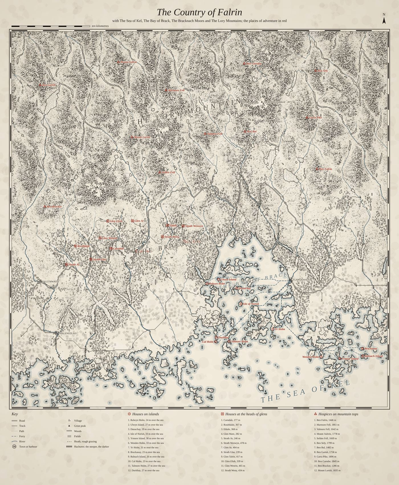

# 6. The world

A world is one stretch of country, forty-eight kilometres square, in which every kind of place is
found rather than drawn: islands in its sea, valley heads in its upland, mountain tops in its range,
and later other kinds in its low country. Each place keeps its own detailed land, made when someone
goes there; the world is what lies between them and round about them, and what is seen from them.

This document says what a world holds, how it is made, what has been measured, and the plan for
joining the places to it, step by step.

## What was asked

The notes, as given:

- "Would it be possible to generate such terrains that the same 'world iteration' could contain areas for all locations? each separately of course then having the detailed close area"
- "so we would need to generate a 'world' height map which would contain: islands; coast; placeholder for forest / farmlands / plains?; valley; mountain tops"
- "Yes proceed! and write a plan as well. I will want also ink map of the world as a deliverable showing the spots for each and imaginary roads(?) or paths(?)"

The answer given before starting: yes. Valleys and islands were already found, not drawn: each in
a frame of its own made by noise and worn (`highlands.ts`, `archipelago.ts`), drawn from a pool of
such frames. Only the mountain top was the other way round, its top drawn first and the country made
round it (`mountain.ts`); but that country is already made as a world needs to be, coarse and then
finer near the mountain. What was missing was one land holding them all.

## What a world holds

All in `src/core/world.ts`, decided from the world's seed alone; nothing in it depends on which
place asks for it.

- **The plan** (`planWorld`): inland is north, turned up to 17 degrees either way, so the sea and its
  islands lie to the south and the mountains to the north (asked: "would prefer orientation of having the
  ocean and islands in south and mountains in the north"); where the coast lies, how far out the shelf of
  islands reaches, how broad the low country and the upland are; four to seven great peaks well back in
  the range; a great bay; and how deep and how far inland its fjords are cut.
- **The zones.** Going inland: open sea; a shelf with islands on it; the coast; the low country;
  the upland; the range. Every point belongs to each zone in a share (`zonesAt`), the shares adding
  to one and blending over a few kilometres where zones meet. The boundaries wander: the coast in
  bays and headlands some kilometres across, the foot of the upland so far that in places it comes
  down to the sea and the low country is gone.
- **The great bay and the fjords** (asked: "how could we have a large bay on the world map extending
  inland and having possibly fjord coasts also?"). The bay is the coast pushed back inland over a stretch
  nine to fourteen kilometres broad at its mouth, ten to fifteen kilometres deep, furthest along its middle
  (which wanders) and rounded at its head. Only the coast is moved: the upland and the range stand where
  they would without it, so the bay cuts past the low country into high ground, and its sides and head are
  steep. Its floor is reckoned as the shelf's near the coast, so it is shallow and has islands in it, and a
  channel a little deeper leads in at its mouth. Fjords are cut wherever the coast is high ground (the
  bay's sides and head, and wherever the upland comes down to the sea): the straths, which already run
  inland, are carried on under the sea between their walls for six to twelve kilometres inland, deepest at
  their mouths and shallowing towards their heads. Where low country lies in front of one, its carved floor
  is cut off from the sea and holds a long loch instead. The world's wear spares the floor of the sea, so
  that what the rivers bring down does not build sills across the fjords.
- **The land**: each zone has a land of its own, and a point's height is each zone's land in the
  share it belongs to that zone (`worldShape`). One sea level for all of it; heights in metres over
  the sea.

  | Zone | Its land | Heights |
  |---|---|---|
  | Open sea, shelf and bay | The archipelago's own land (as `archipelago.ts`), lowered to stand in the world's sea, sparser and deeper further out | islands to 20–110 m, sea floor to −300 |
  | Low country | Long gentle swells rising from the shore to the foot of the upland | 0 to about 200 m |
  | Upland | Broad straths running inland, and between them the glens of the valleys' frame (`highlands.ts`), branching, coming down into the straths | floors 60–400 m, tops to 800 |
  | Range | Great valleys running inland, crossing and joining; side valleys down into them; massifs and cols along the ridges; a mass under each great peak | floors 330–800 m, summits 1,000–2,300, great peaks 2,300–3,000 |

- **Worn**, on a lattice of 48 metres, a thousand and one points a side, by the same water and
  frost as every other land (`terrain.ts`), deeper than a site's own: so that rivers cut real valleys.
  The shelf is spared here (its islands are a few points across at this size) and worn in the tiles.
  Its shape from before the wear is kept too: the tiles need it.
- **Water.** The sea is whatever lies below its level joined to the world's edge. Then the water is
  followed: hollows are filled to where they would spill, each point drains to its steepest neighbour
  downhill, and what drains through each point is counted (`drain`). A hollow deeper than sixty metres
  has an outlet cut from its lowest point out through where it would spill, as a river cuts a gorge
  (`breach`); shallower ones are lakes. Rivers are drawn from where four square kilometres drain through
  a point, down to the sea.
- **Cover**: what lies at each point, from its height, its slope, how wet it is and its zone:
  sea, lake, shore, marsh, fields, pasture, forest, heath, rock or snow (`COVER`). Fields on gentle low
  ground; woods on slopes and in patches, thinning up the upland, whose higher ground is heath with the
  woods down in its glens; heath above the trees (the treeline wanders about 640 metres); rock where it
  is steep or very high; snow all year above about 1,900.
- **Tiles**: a finer lattice, 20 metres, in tiles 7.2 kilometres square on a fixed grid, a tile
  every six kilometres, each reaching 600 metres over its neighbours (`worldTile`). A tile is the
  world's fine shape (more octaves of each zone's noise) with what the world's wear did laid on it, so
  the rivers keep their valleys; worn again at its own scale, as an island's or a valley's own frame
  is; and drained. Because the grid is the world's, a tile's land is the same whichever place asks.
- **Places**, looked for where their kind of land is, two kilometres in from the world's edge at least (each list best first, twelve of each kept):
  - *Islands*: in the tiles where the shelf has land, by the islands' own search (`findIslands`),
    told that the sea stands at the world's level instead of trying twenty levels of its own. An
    island of some 200 to 400 metres across on the whole (its farthest point up to some 300 metres from
    its middle), near enough round, with ground for the house 18 to 34 metres over the sea, well in from
    its cliffs. One house to an island.
  - *Valley heads*: in the tiles of the upland, by the valleys' own search (`findValleys`) on the
    tile's drainage: where a stream begins to be one, with a floor falling gently below and walls
    on both hands. No two within a kilometre and a half.
  - *Mountain tops*: on the world's lattice, in the range: a summit that stands alone over the
    cloud (nothing higher joined to it above a level 150 metres under its top, within three
    kilometres, and nothing higher at all within 900 metres), 600 metres or more over the valleys
    two to three kilometres off, not on a great peak's flanks, and with a ridge down from it that a
    way could come up (falling steadily for 900 metres along a crest, the ground lower on both hands).
- **Towns**, as placeholders for what the low country will one day hold: a harbour at a river's
  mouth, the nearer the islands the better; up to four market towns on rivers in the low country,
  seven kilometres apart; up to fourteen villages by water on fields and pasture.
- **Ways**: roads joining the towns by the shortest set of links; tracks from the villages and the
  valley heads to the nearest way; paths up each mountain top's ridge and from its foot to the nearest
  way; ferries from the harbour to each island, round the land. Each laid over the land as a walker or
  a cart would: round a hill rather than over it, along a slope rather than up it, across a river
  where it must, onto a way already made where one goes the right way.
- **Names** (`names.ts`): the world, its sea, its upland and its range, the great peaks, every town,
  every place. A northern country of sounds, glens and fells: a made-up root with the word a map would
  put with it ("Glen Ashra", "Ben Kilra", "Isle of Glasrin", "Wenrahaven").

## The ink map

`world.html` makes a world in a worker (`src/worldmap/`) and draws it (`src/maps/inkWorld.ts`), in
the hand of the place's own ink map: the coast a firm line with the sea in lines following it; the
relief in hachures, strokes down the fall of the ground, heavier where it is steeper, higher, and
turned away from the light, none on the snow; woods as little trees, fields as strips, heath and marsh
by their marks; rivers swelling to the sea and lakes with ripples; roads as a pair of lines, tracks
single, paths dotted, ferries broken lines over the water; towns as huddles of buildings, a village
with its church. The places of adventure are in red, as an old map picks out what matters: an
island's house a ring, a valley's a square with a cross, a mountain top's a triangle; and listed
under the map by kind with their heights, beside the key. **Relief** shows the same world as shaded
relief coloured by cover, for judging it; **Save picture** keeps either. `?world=<seed>` names the
world. `tools/browser/worldmap.cjs` saves both pictures of any worlds without a person at the page.

## Measured

Without a browser, in a cloud container with four cores (`npx tsx tools/world.ts`), November 2026:
a world builds in 25 to 33 seconds; in the browser (Chromium, headless, on the same machine) the world
page makes and draws one in 25 to 28. Every world tried gave twelve places of each kind, nineteen towns
(the harbour, four towns and fourteen villages) and a hundred or so rivers.

What the time goes on, measured stage by stage for one world (`w2`): the shape 1.7 seconds; the wear by
water 10.6 (a million drops, each running up to ninety steps), by frost 0.3; cutting outlets and following
the water 0.8; the cover 0.4; then the tiles, 10 to 15 of them, each 1.25 seconds, of which 1.07 is its wear
by water (130,000 drops), 0.11 its shape and 0.07 its frost and drainage; the summits, towns, ways and names
under half a second together. So some nine tenths of the time is the drops. What could be done about it,
cheapest first: keep the world once made (in the browser's storage, some ten megabytes with its tiles), so
that only the first visit pays; wear the tiles side by side, one worker to a core, since each is made alone
(on four cores, their twelve to eighteen seconds to four or five); fewer drops on the world's lattice (half
as many, half the time, the rivers' valleys a little shallower); or the drops run on the graphics card, which
is a piece of work of its own.

What it took to make the land drain, for whoever changes it next: first the range was made of the
ridged noise's crests alone, as the mountain's country is, and the hollows between the crests filled
as lakes, 29% of the world. Valleys made as networks of ridged noise turned over (the upland's glens)
had floors that rose and fell by hundreds of metres along their length, since the noise's crest
wavers. Valleys made as the lines where smooth noise crosses its middle had level floors but closed in
rings round hills. The great valleys and the straths are now level lines of the distance along the
coast, pushed about by noise too gently to close, in two families turned apart so that they cross and
join; and every lesser network fades out on the floor of the greater, so that it runs down into it
and does not dam it. Before that last, a count of one world's hollows deeper than 160 metres went from
94, covering 8% of the world, to 3. `breach` cuts what is left.

## The plan, in steps

Each step is a slice that can be judged on its own. Nothing a site already makes changes until a
world is asked for: a world is a mode, `?world=<seed>`, beside the seeds already seen.

1. **The world, and its map.** *Done*: everything above. Nothing in the game reads a world yet.
2. **Valleys and islands found in the world.** With `?world=<seed>&place=island&n=3` (or `valley`), the
   site is made on the third island (valley head) of that world, its house still from its own seed.
   The island's frame becomes the world's tile about the spot instead of a pooled sea of islands; the
   valley's the same for its upland. What needs doing: a 5-metre lattice made from the tile as the tile
   is made from the world, on the same fixed grid one level down; the island's and the valley's code
   given the world's tile and spot where it now takes a pooled frame and a spot in it (`islandFrame`,
   `valleyFrame` and the heights read through them); the sea at the world's level, so the island is laid
   out with `sea` as found, not chosen. Checks: `tools/island.ts` and `tools/land.ts` with a world, the
   browser scripts on a few, and the house's ground levelled with little cut, as now.
3. **Mountain tops placed on the world's summits.** The mountain top is drawn and its country made
   round it; in a world its top is fitted to the summit found (its rim, ridge and summits laid where the
   summit and its ridge are, turned to the ridge), and its country is the world's: the tiles near, the
   world's lattice beyond, in place of `countryShape` and its two lattices. The great peaks the site
   draws far off become the world's great peaks and the summits round about. The cloud stays weather,
   set for each visit under the rim, so it binds nothing in the world.
4. **One far land, from the world.** The three far sheets (the valley's hills in `landscape.ts`, the
   island's mainland, the mountain's range) become one reading of the world, out to thirty or fifty
   kilometres, so that from an island the range stands on the skyline and from a summit the sea shows
   through the cloud. More rings, coarse ones, cost few triangles; the haze needs work at that distance,
   and the curve of the earth too (at forty kilometres the ground falls some 125 metres below the line
   of sight).
5. **The map leads to the places.** Each place on the world's map a link to it; the place's own ink map
   with the world's around it; the site document gains an optional reference to its world and its spot
   (`docs/05-site-format.md`).
6. **More kinds of place, where the world has room for them.** The low country and the coast are
   there, with cover, rivers, towns and roads, and no place is yet looked for in them: a village, a
   castle on the plain, a clearing in a forest, a house on a mainland headland. Each needs only its
   search, and its own site.

Later, and smaller: neighbours seen from a place (another island's lighthouse lit at night) once the
world records every place; the world kept between visits (in the browser's storage, some four
megabytes of heights) so that only the first visit pays the half minute; a check of many worlds
(`tools/world.ts` with a count) that reports, for each, how many of each kind were found and why the
rest were turned down.

## Open questions

- **How big.** Forty-eight kilometres was chosen so that each zone has ten or fifteen of them and a
  place's views (seven kilometres now, thirty or more after step 4) lie inside it. A smaller world is
  quicker to make; a larger one would need its tiles made only where a place is wanted.
- **Which way the land goes.** Every world is sea, coast, low country, upland, range, in that order,
  inland. Other orders (a range down the middle with sea on both sides; an inland sea) are a change to
  the plan and the zones only.
- **Whether a place's own land should be changed where it was found.** An island's cliffs are cut and
  its house's ground levelled in the island's own land, finer than the world's; seen from elsewhere, the
  world shows the island as found. That is fine at a distance and wrong close to, which matters only once
  one place can be seen from another nearby.
